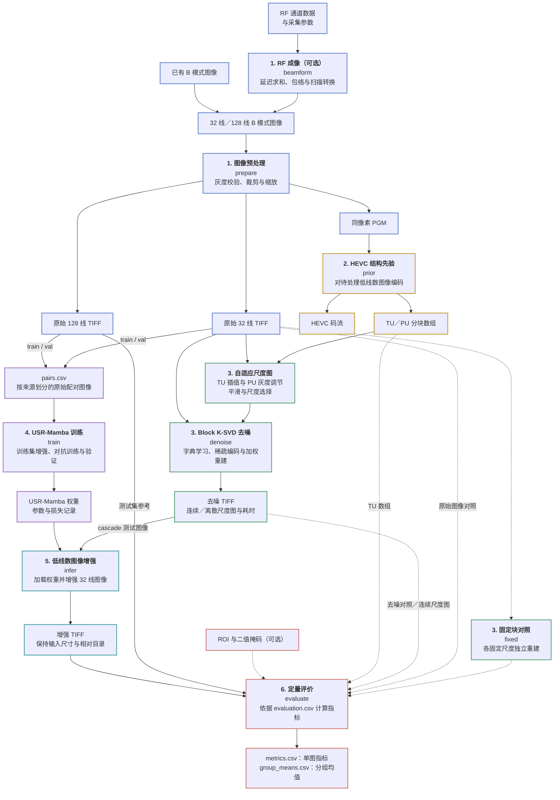
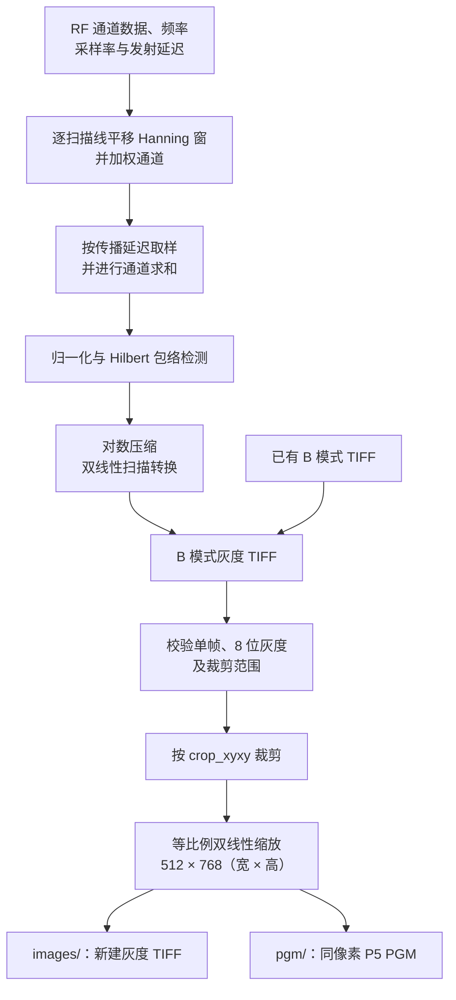
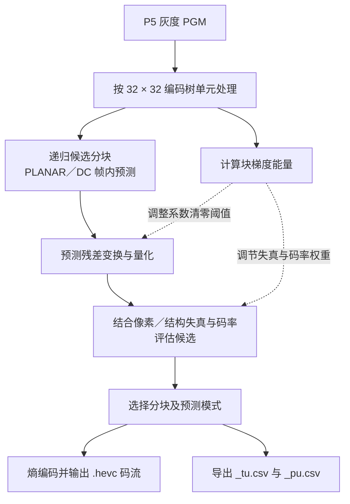
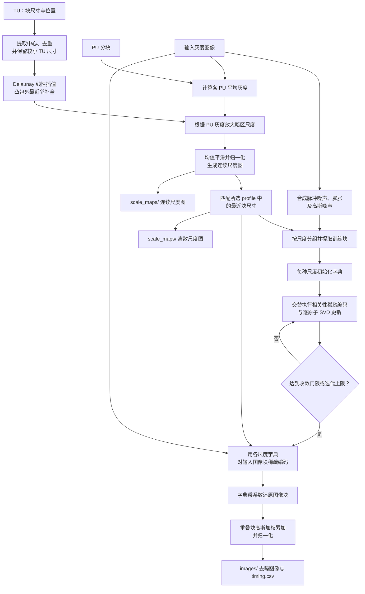
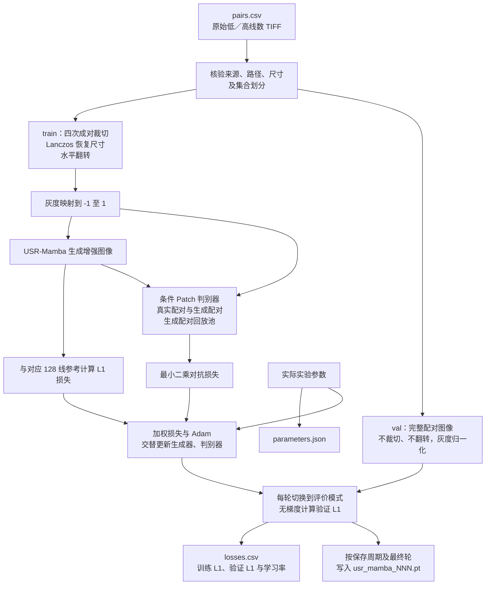
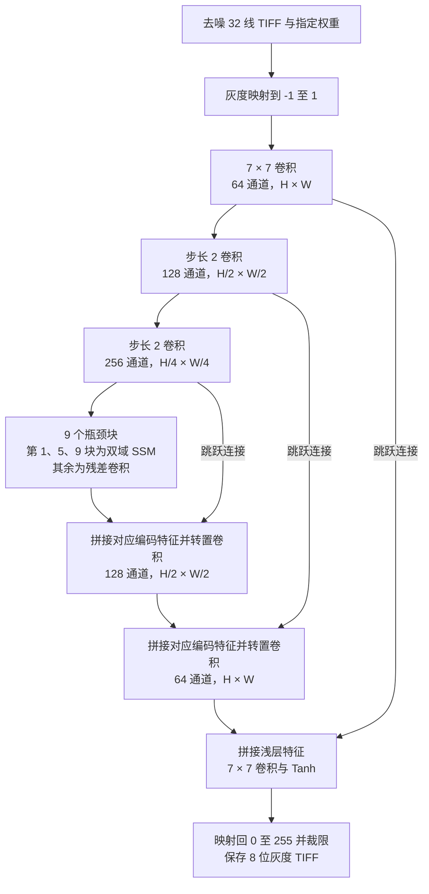
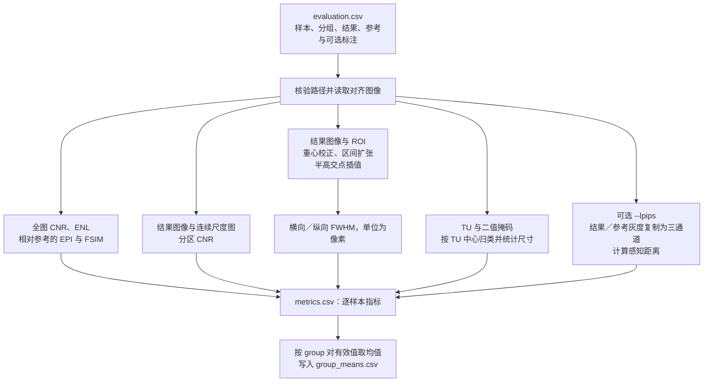

# 基于自适应压缩感知与状态空间模型的超声图像增强方法

本项目实现从超声 RF 数据或 B 模式图像出发，提取 HEVC 分块结构先验，进行自适应 Block K-SVD 去噪，再通过 USR-Mamba 增强低线数图像并计算评价指标的完整流程。[最终论文](thesis.pdf)保留在根目录。

论文主路径为 **32 线图像 → HEVC 结构先验 → 三尺度 Block K-SVD 去噪 → USR-Mamba 推理 → 与原生 128 线参考图像比较**。网络训练使用预处理后的原始 32 线／128 线配对图像；前级去噪接入推理路径。32／128 表示波束线数，网络输入输出保持相同像素尺寸。

## 完整流程图

实线表示主要处理和数据依赖，虚线表示可选对照或辅助评价输入。图中的阶段名与 `run.py` 子命令对应；训练、推理和评价通过清单、权重及输出目录衔接，需要分别执行。阶段编号与下方分步说明一致，以边框颜色区分阶段，文字和底色跟随显示主题。



Block K-SVD 提供两组配置：`cascade` 使用 4、8、12 三种块尺寸，作为 USR-Mamba 前级；`denoising` 使用 4、8、12、16、20、24 六种块尺寸，用于独立去噪实验。完整图中的 `denoise` 按所选配置分别运行，`fixed` 为各固定块尺寸生成独立对照结果。

## 阶段与代码入口

| 阶段 | 目录 | 输入与输出 |
| --- | --- | --- |
| 1. 成像与预处理 | `imaging/` | `beamform`（可选）、`prepare`：RF 或 B 模式图像 → 对齐的灰度 TIFF／PGM |
| 2. 结构先验 | `hevc_prior/` | `prior`：PGM → HEVC 码流、TU／PU 数值数组 |
| 3. 自适应稀疏去噪 | `block_ksvd/` | `denoise`／`fixed`：图像及先验 → 去噪图像、尺度图与耗时 |
| 4. 网络训练 | `usr_mamba/` | `train`：原始低／高线数配对图像及清单 → 权重与训练／验证记录 |
| 5. 状态空间增强 | `usr_mamba/` | `infer`：去噪低线数图像及权重 → 增强图像 |
| 6. 指标计算 | `evaluation/` | `evaluate`：配准图像、尺度图及标注 → 单图与分组指标 |

`run.py` 提供统一入口，`configs/paper.json` 集中定义实验参数；数据位置、输出位置、MATLAB、编码器和计算设备均由命令行传入。`common/` 只处理配置、输入约定及 MATLAB 调用。

## 分步处理流程

### 1. RF 成像与图像预处理

输入可为包含通道信号及物理采集参数的 MAT 文件，也可为已有的单帧 8 位灰度 TIFF。RF 输入先通过 `beamform` 生成 B 模式 TIFF，已有图像直接进入 `prepare`。低／高线数配对必须配准并采用相同预处理，训练、验证和测试来源由数据提供者事先划分。



默认裁剪窗口为 `(0,0,750,1125)`，右／下边界不包含在裁剪区域内。预处理输出保留中性文件名及相对目录，并重新写入像素，移除原 TIFF 元数据。HEVC 输入宽高须为 32 的倍数。

对应实现：[RF 成像](imaging/beamform_rf.m)、[预处理](imaging/preprocess.py)。

### 2. HEVC 结构先验提取

`prior` 对 PGM 进行帧内编码，利用图像结构决定预测单元（PU）和变换单元（TU）的分块。后续去噪读取的是分块数组，图像像素来自预处理 TIFF。



质量索引 0–4 对应 QP 4、10、16、22、28，默认索引为 0。TU／PU CSV 均无表头，每行是 `[block_size,x,y]`，坐标以左上角为原点、从 0 开始；相对目录和样本名与输入一致。

对应实现：[先验提取入口](hevc_prior/runner.py)、[编码器](hevc_prior/codec.c)。

### 3. 自适应尺度图与 Block K-SVD 去噪

`denoise` 将图像、TU 和 PU 结合，先生成每个像素的块尺度，再按实际出现的尺度分别学习字典和重建。字典训练图像由当前输入叠加合成脉冲／高斯噪声得到；最终稀疏重建使用当前输入图像的块。



中心不足或共线时，尺度插值回退到最近邻。默认字典为 512 个原子、稀疏率 0.1、最多迭代 10 轮。连续尺度图用于后续尺度分区评价，离散尺度图决定逐像素块尺寸。

| `--profile` | 块边长（像素） | 用途 |
| --- | --- | --- |
| `cascade` | 4、8、12 | USR-Mamba 推理前级 |
| `denoising` | 4、8、12、16、20、24 | 独立去噪与固定块对照 |

`fixed` 跳过 TU／PU 尺度估计，对配置中的每种固定块尺寸分别学习、重建，并使用等权重融合；同一图像的各固定尺度共享同一份合成训练噪声。结果写入 `images/fixed_04/` 等目录。

对应实现：[批量去噪](block_ksvd/batch_denoise.m)、[尺度图](block_ksvd/scale_map.m)、[字典学习](block_ksvd/dictionary_learning.m)、[稀疏编码](block_ksvd/sparse_encode.m)、[重建与融合](block_ksvd/reconstruct_image.m)。

### 4. USR-Mamba 配对训练与独立验证

`train` 读取 `pairs.csv`，以预处理后的原始 32 线图像为输入、原始 128 线图像为参考。清单包含 `source_id,split,input,reference`，`split` 为 `train`、`val` 或 `test`；训练入口只使用前两者，并核验来源及文件划分。



默认批量为 1、学习率为 0.0002、Adam 参数为 `(0.5,0.999)`；先恒定学习率训练 30 轮，再线性衰减训练 30 轮。生成器损失为 `10 × L1 + 1 × 最小二乘对抗损失`。每个训练来源得到四组确定的成对裁切，只裁左右和底部 0–32 像素、顶部不变，再通过水平翻转形成八个样本；验证集保持独立。权重默认每 5 轮及最终轮保存，记录模型结构与变体。

`--variant` 支持完整模型 `full`，以及纯卷积瓶颈 `conv_bottleneck`、去傅里叶分支 `no_fourier`、去 SSM 后残差精炼 `no_refinement`、行优先扫描 `raster_scan` 四种结构消融。

对应实现：[配对数据与划分](usr_mamba/dataset.py)、[训练与验证](usr_mamba/training.py)。

### 5. USR-Mamba 网络与低线数推理

`infer` 加载指定权重及其中记录的模型结构，对 `cascade` 输出的去噪 32 线图像进行增强。以下是默认完整模型的数据流，`H × W` 表示输入的高和宽。



双域 SSM 包含两条分支：空间特征经二维扫描、LayerNorm 和 Mamba 后还原；频域特征经二维 FFT 与中心化，将实部／虚部拼接后扫描建模，再逆变换回空间域。两分支融合后，与输入特征拼接融合，并进行残差卷积精炼。默认扫描顺序为从边界向中心逐层绕行的 `outside_in`。

推理采用评价模式并关闭梯度，输入宽高须能被默认下采样因子 4 整除。输出保留尺寸、样本名和相对目录。原始 32 线输入对照可使用相同权重另行执行 `infer`。

对应实现：[网络结构](usr_mamba/network.py)、[推理与图像保存](usr_mamba/inference.py)。

### 6. 定量评价与分组统计

`evaluate` 读取 `evaluation.csv`，每行指定参考图像、方法结果及可选的连续尺度图、ROI、TU 和掩码。结果与参考必须处于相同像素坐标系；原始输入、固定块去噪、自适应去噪和网络增强结果可分别建立清单进行比较。



全图 `global_cnr` 使用均值／样本标准差，ENL 使用均值平方／样本方差；EPI 使用 Sobel 梯度相关。FSIM 使用多尺度 LoG 相位响应近似，具体口径见[复现指南](docs/reproduction.md)。尺度分区 CNR 默认将连续尺度图的 `[0,4)` 作为目标、`(8,12]` 作为背景、`[0,12]` 作为噪声统计范围。

缺少对应尺度图、ROI 或 TU／掩码时，相关指标保留为缺失值（NaN）；LPIPS 通过 `--lpips` 显式启用，需要额外特征评价依赖和公开特征权重。

对应实现：[评价入口](evaluation/runner.py)、[MATLAB 批量指标](evaluation/evaluate_batch.m)。

## 运行与复现

依次使用 `beamform`（可选）、`prepare`、`prior`、`denoise` 准备图像；通过 `train` 得到权重后执行 `infer`，最后通过 `evaluate` 汇总结果。已有兼容权重时可直接进入推理；`fixed` 及各网络变体用于独立对照。输入清单、标注和数据划分需事先准备。

环境安装、编码器构建和各阶段命令见[复现指南](docs/reproduction.md)，输入与清单格式见[数据契约](docs/data_contract.md)，已完成的合成验证及实测范围见[验证记录](docs/validation.md)。

归档包含流程源码、参数、必要许可证与论文，不包含采集数据、样本清单、ROI 实测标注、权重、实验结果、安装环境、编译产物或开发备份。运行目录默认排除在 Git 之外。

```sh
python -B run.py --help
python -B tools/verify_archive.py
```
