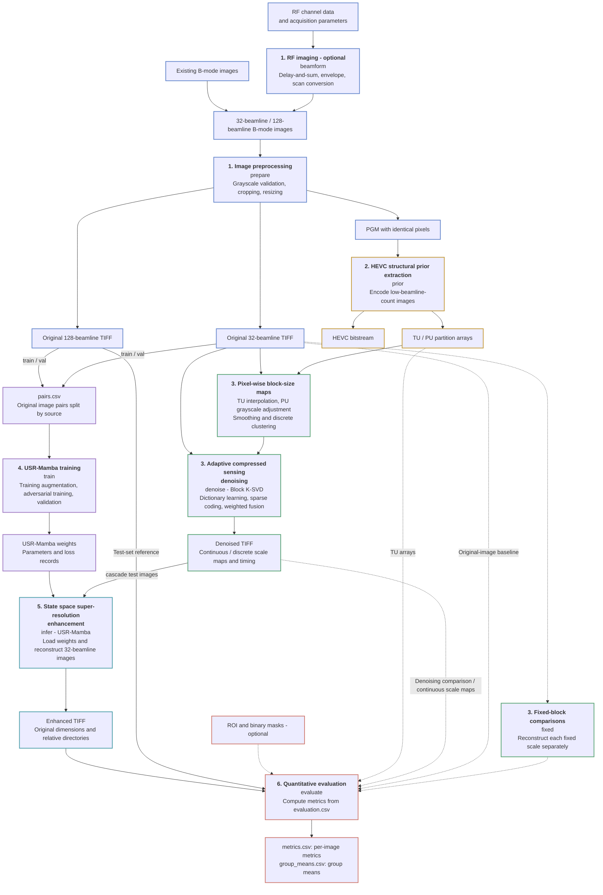
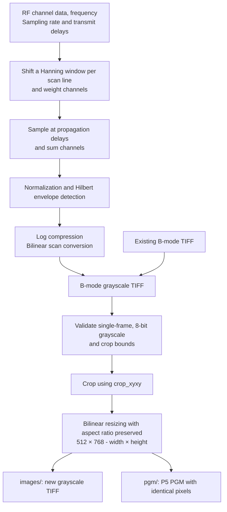
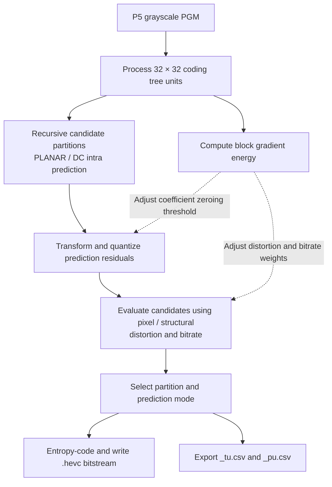
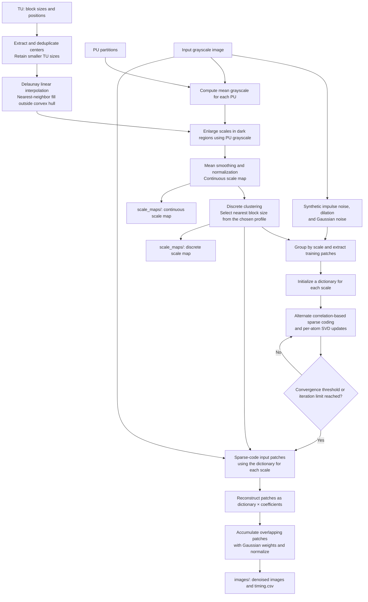
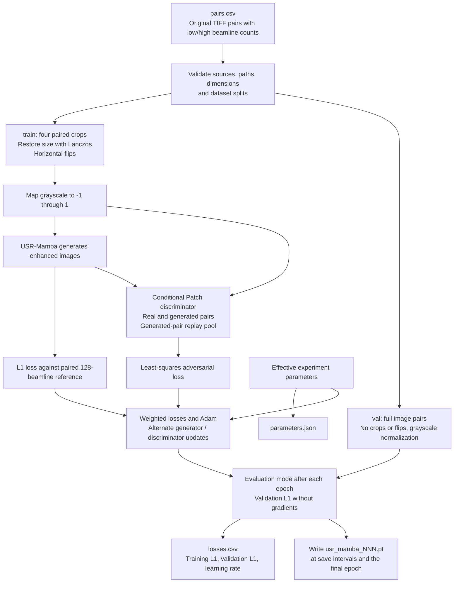
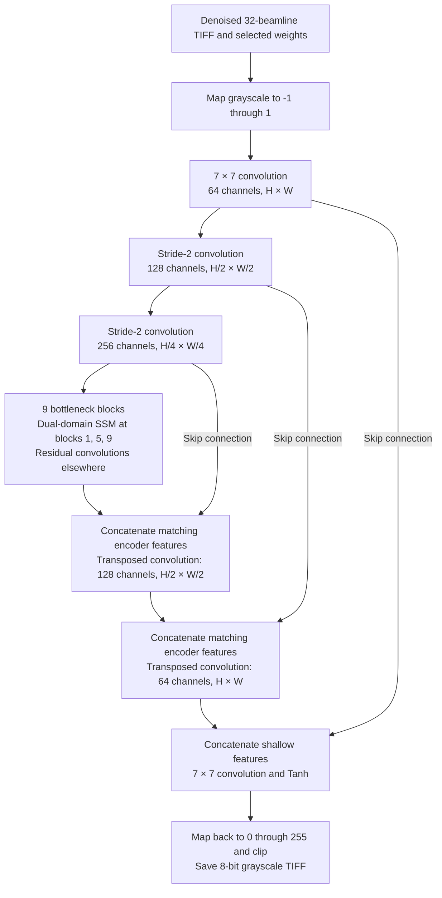
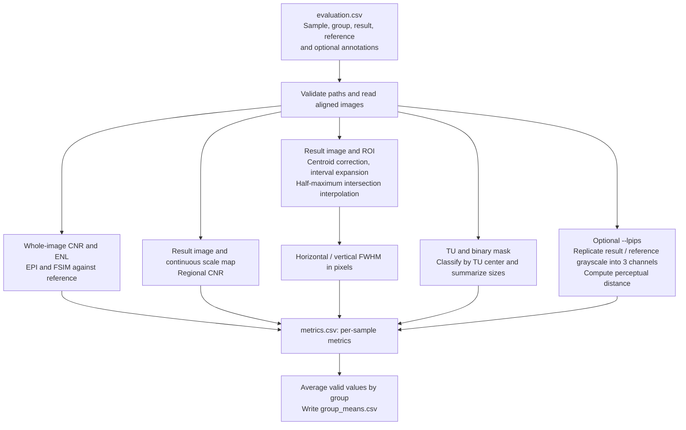

# An Ultrasound Image Enhancement Method Based on Adaptive Compressed Sensing and State Space Model

Language: English | [简体中文](README_zh-CN.md)

This project implements the ultrasound image enhancement method described in the [final thesis](thesis.pdf), following the pipeline **structural prior extraction → adaptive compressed sensing denoising → state space super-resolution enhancement**. It extracts structural priors from High Efficiency Video Coding (HEVC) block partitions, performs structural-prior-guided adaptive block K-SVD denoising (Block K-SVD), and reconstructs low-beamline-count B-mode images with the USR-Mamba super-resolution network. RF imaging, image preprocessing, network training, and quantitative evaluation complete the implementation.

The main thesis pipeline is **32-beamline images → HEVC structural priors → three-scale Block K-SVD denoising → USR-Mamba super-resolution reconstruction → comparison with native 128-beamline reference images**. Network training uses preprocessed original 32-beamline/128-beamline image pairs; the denoising stage is applied during inference. The numbers 32 and 128 refer to beamline counts. Super-resolution here learns the mapping between these imaging conditions; network inputs and outputs retain the same pixel dimensions.

## Complete Workflow

Solid arrows indicate the main processing steps and data dependencies; dashed arrows indicate optional comparisons or auxiliary evaluation inputs. Stage names match the `run.py` subcommands. Training, inference, and evaluation are connected through manifests, weights, and output directories, and must be run separately. Stage numbers match the steps below. Border colors distinguish stages, while text and backgrounds follow the display theme.



Block K-SVD provides two profiles: `cascade` uses block sizes 4, 8, and 12 before USR-Mamba; `denoising` uses six sizes, 4, 8, 12, 16, 20, and 24, for standalone denoising experiments. In the complete workflow, `denoise` runs with the selected profile, while `fixed` generates a separate comparison result for each fixed block size.

## Stages and Code Entry Points

| Stage | Directory | Inputs and outputs |
| --- | --- | --- |
| 1. Imaging and preprocessing | `imaging/` | `beamform` (optional), `prepare`: RF or B-mode images → aligned grayscale TIFF / PGM |
| 2. Structural prior extraction | `hevc_prior/` | `prior`: PGM → HEVC bitstreams and numerical TU / PU arrays |
| 3. Adaptive compressed sensing denoising | `block_ksvd/` | `denoise` / `fixed`: images and priors → denoised images, scale maps, and timing |
| 4. Network training | `usr_mamba/` | `train`: original image pairs with low/high beamline counts and manifest → weights and training/validation records |
| 5. State space super-resolution enhancement | `usr_mamba/` | `infer`: denoised low-beamline-count images and weights → super-resolution reconstructions |
| 6. Metric computation | `evaluation/` | `evaluate`: registered images, scale maps, and annotations → per-image and group metrics |

`run.py` is the unified entry point, and `configs/paper.json` defines the experiment parameters. Data locations, output locations, MATLAB, the encoder, and the computing device are supplied through command-line arguments. `common/` handles configuration, input conventions, and MATLAB invocation.

## Repository Layout

```text
hevc-ksvd-mamba-for-ultrasound/
|-- README.md                    English documentation.
|-- README_zh-CN.md              Simplified Chinese documentation.
|-- thesis.pdf                   Final thesis.
|-- run.py                       Unified command-line entry point.
|-- CMakeLists.txt               HEVC encoder build configuration.
|-- requirements.txt             Core Python dependencies.
|-- requirements-perceptual.txt  Optional perceptual-evaluation dependencies.
|-- LICENSE                      Project license.
|-- .gitignore                   Excludes local data, outputs, builds, and editor files.
|-- configs/
|   `-- paper.json               Experiment parameters.
|-- common/                      Configuration, input conventions, and MATLAB invocation.
|-- imaging/                     RF beamforming and image preprocessing.
|-- hevc_prior/                  HEVC encoder and partition-prior extraction.
|-- block_ksvd/                  Scale maps, dictionary learning, sparse coding, and reconstruction.
|-- usr_mamba/                   Paired data, network, training, and inference.
|-- evaluation/                  Image, region, partition, and perceptual metrics.
|-- docs/
|   |-- reproduction.md          Environment setup and stage commands (Chinese).
|   |-- data_contract.md         Input and manifest formats (Chinese).
|   |-- validation.md            Validation record and tested scope (Chinese).
|   `-- archive_manifest.json    Archive file inventory and SHA-256 hashes.
|-- licenses/
|   `-- third_party.txt          Third-party license notices.
`-- tools/
    |-- smoke_test.py            Synthetic end-to-end validation.
    `-- verify_archive.py        Archive scope and integrity verification.
```

Both README files describe the same pipeline, equations, and code entry points. Local `work/`, data, output, weight, build, and editor workspace files are excluded by `.gitignore` and are not part of the tracked source layout above.

## Thesis Equation Index

The following sections organize all **39 numbered equations** from Chapters 2–4 of the [final thesis](thesis.pdf) by processing stage, retaining the original equation numbers and adding symbol definitions, parameters, and code references. Equations labeled “Implementation supplement” expand the current program's calculations and do not use thesis equation numbers. Symbols may be reused across chapters; each group defines them separately.

| Equations | Topic | README location |
| --- | --- | --- |
| (2-1)–(2-5) | Quantization selection, rate-distortion cost, sum of squared errors, and base weights | [HEVC equations](#paper-hevc-equations) |
| (2-6)–(2-12) | Structural distortion, gradients in both directions, dynamic weights, and TU gradient energy | [HEVC equations](#paper-hevc-equations) |
| (2-13)–(2-15) | Base and adaptive coefficient-group zeroing thresholds | [HEVC equations](#paper-hevc-equations) |
| (3-1)–(3-7) | Sparse representation, atom selection, residuals, SVD updates, and overlap fusion | [K-SVD equations](#paper-ksvd-equations) |
| (3-8)–(3-12) | TU interpolation, PU grayscale scaling, scale normalization, multiple dictionaries, and Gaussian windows | [Adaptive scale equations](#paper-scale-equations) |
| (4-1)–(4-6) | Encoding, bottleneck, dual-domain branches, decoding, and scan-state updates | [USR-Mamba equations](#paper-mamba-equations) |
| (3-13)–(3-18) | CNR, ENL, EPI, FSIM, FWHM, and weighted evaluation of scale regions | [Evaluation equations](#paper-metric-equations) |
| Implementation supplements | Input normalization, training losses, learning rate, regional CNR, and more | [Training equations](#implementation-training-equations), [evaluation equations](#paper-metric-equations) |

## Processing Steps

### 1. RF Imaging and Image Preprocessing

Input can be a MAT file containing channel signals and physical acquisition parameters, or an existing single-frame 8-bit grayscale TIFF. RF input first passes through `beamform` to produce B-mode TIFF; existing images enter `prepare` directly. Image pairs with low/high beamline counts must be registered and use the same preprocessing. The data provider must split sources into training, validation, and test sets in advance.



The default crop window is `(0,0,750,1125)`, excluding the right and bottom boundaries. Preprocessing preserves neutral filenames and relative directories, and rewrites pixels to remove the original TIFF metadata. HEVC input width and height must be multiples of 32.

Implementation: [RF imaging](imaging/beamform_rf.m), [preprocessing](imaging/preprocess.py).

### 2. Structural Prior Extraction from HEVC Block Partitions

`prior` performs intra coding on PGM images, using image structure to determine prediction unit (PU) and transform unit (TU) partitions. The thesis restricts intra-prediction modes, reformulates the rate-distortion cost, and adapts the quantization zeroing threshold to obtain finer partitions around tissue boundaries, bright targets, and high-frequency textures. Subsequent denoising reads these structural prior arrays; image pixels come from the preprocessed TIFF.



Quality indices 0–4 correspond to QP values 4, 10, 16, 22, and 28; the default index is 0. TU / PU CSV files have no header. Each row is `[block_size,x,y]`, with zero-based coordinates originating at the top-left corner. Relative directories and sample names match the input.

<a id="paper-hevc-equations"></a>

#### Thesis Equations: Rate-Distortion and Structure-Adaptive Quantization

Let $`c_i`$ be transform coefficient $`i`$, $`l_{i,k}`$ its candidate quantized value $`k`$, $`D(c_i,l_{i,k})`$ the quantization distortion, $`R(l_{i,k})`$ the coded bit count, and $`\lambda`$ the Lagrange multiplier. The thesis selects quantized values using:

```math
l_i^*=\underset{k}{\mathrm{argmin}}
\left\{D(c_i,l_{i,k})+\lambda R(l_{i,k})\right\}.
\qquad\text{(2-1)}
```

Here $`l_i^*`$ denotes the quantized value of the optimal candidate above. Let $`X_{\mathrm{orig}}`$ and $`X_{\mathrm{rcon}}`$ be the original and reconstructed blocks. The conventional rate-distortion cost is:

```math
\mathrm{RD}_{\mathrm{cost}}
=D_{\mathrm{SSE}}(X_{\mathrm{orig}},X_{\mathrm{rcon}})+\lambda R.
\qquad\text{(2-2)}
```

The encoder uses the discrete quality index $`q=\mathrm{qpd6}\in\{0,1,2,3,4\}`$ to look up distortion and bit-count weights, equivalently written as:

```math
\mathrm{RD}_{\mathrm{cost}}
=w_d(q)D_{\mathrm{SSE}}+w_b(q)R.
\qquad\text{(2-3)}
```

```math
D_{\mathrm{SSE}}
=\sum_{i=0}^{\mathrm{sz}-1}\sum_{j=0}^{\mathrm{sz}-1}
\left(X^{\mathrm{orig}}_{i,j}-X^{\mathrm{rcon}}_{i,j}\right)^2.
\qquad\text{(2-4)}
```

```math
\begin{cases}
w_d(q)=[11,11,11,5,1]_q,\\
w_b(q)=[1,4,16,29,23]_q.
\end{cases}
\qquad\text{(2-5)}
```

Here $`\mathrm{sz}`$ is the TU side length and $`R`$ is the current TU's coded bit count. The index $`q`$ corresponds to `quality_index` in the configuration; the QP value itself is not used as the array index.

The modified cost adds a gradient-difference penalty between the original and reconstructed blocks, and adjusts both weights dynamically:

```math
\mathrm{RD}'_{\mathrm{cost}}=w'_dD_{\mathrm{struct}}+w'_bR.
\qquad\text{(2-6)}
```

```math
D_{\mathrm{struct}}=D_{\mathrm{SSE}}
+\sum_{i=1}^{\mathrm{sz}-2}\sum_{j=1}^{\mathrm{sz}-2}
\left(
\left|G_x^{\mathrm{orig}}-G_x^{\mathrm{rcon}}\right|
+\left|G_y^{\mathrm{orig}}-G_y^{\mathrm{rcon}}\right|
\right).
\qquad\text{(2-7)}
```

```math
\begin{cases}
G_x^{\mathrm{orig}}=X^{\mathrm{orig}}_{i,j+1}-X^{\mathrm{orig}}_{i,j-1},\\
G_y^{\mathrm{orig}}=X^{\mathrm{orig}}_{i+1,j}-X^{\mathrm{orig}}_{i-1,j}.
\end{cases}
\qquad\text{(2-8)}
```

```math
\begin{cases}
G_x^{\mathrm{rcon}}=X^{\mathrm{rcon}}_{i,j+1}-X^{\mathrm{rcon}}_{i,j-1},\\
G_y^{\mathrm{rcon}}=X^{\mathrm{rcon}}_{i+1,j}-X^{\mathrm{rcon}}_{i-1,j}.
\end{cases}
\qquad\text{(2-9)}
```

```math
w'_d=
\begin{cases}
\min\left\{w_d(q)+\min\{G_{\mathrm{TU}}-1,12\},24\right\},
&G_{\mathrm{TU}}>2,\\
w_d(q),&G_{\mathrm{TU}}\le2.
\end{cases}
\qquad\text{(2-10)}
```

```math
w'_b=
\begin{cases}
\max\left\{w_b(q)-\min\{G_{\mathrm{TU}}-1,12\},1\right\},
&G_{\mathrm{TU}}>2,\\
w_b(q),&G_{\mathrm{TU}}\le2.
\end{cases}
\qquad\text{(2-11)}
```

```math
G_{\mathrm{TU}}=\frac{1}{\mathrm{sz}^2}
\sum_{i=1}^{\mathrm{sz}-2}\sum_{j=1}^{\mathrm{sz}-2}
\left(\left|G_x^{\mathrm{orig}}\right|+\left|G_y^{\mathrm{orig}}\right|\right).
\qquad\text{(2-12)}
```

Gradients are computed only inside the block, but energy is normalized by the full block area $`\mathrm{sz}^2`$. High-gradient regions increase the distortion weight and decrease the bit-count weight, giving fine structures greater importance when comparing candidates. The current C encoder uses integer division for $`G_{\mathrm{TU}}`$. The structural gradient-difference coefficient is controlled by `structure_weight`, which defaults to 1.

The original, base, and adaptive coefficient-group (CG) zeroing thresholds are:

```math
T_{\mathrm{CG}}=\frac{9\times2^{\mathrm{sft}}}{4}
=9\times2^{\mathrm{sft}-2}.
\qquad\text{(2-13)}
```

```math
T_{\mathrm{base}}=T_{\mathrm{CG}}=9\times2^{\mathrm{sft}-2}.
\qquad\text{(2-14)}
```

```math
T_{\mathrm{adaptive}}=
\begin{cases}
\max\{T_{\mathrm{base}}/2,1\},&G_{\mathrm{TU}}>2,\\
T_{\mathrm{base}},&G_{\mathrm{TU}}\le2.
\end{cases}
\qquad\text{(2-15)}
```

Here $`\mathrm{sft}=\mathrm{LEVEL\_SHIFT\_TABLE}[\mathrm{sz}/8]+q`$, with table indexing interpreted using the encoder's integer arithmetic. The code uses bit shifts for threshold scaling and integer truncation; `zero_multiplier=9`, `zero_shift=2`, and `zero_reduction_shift=1` give the defaults above. This threshold only controls coefficient-group zeroing; candidate quantization levels are still compared by cost.

Implementation: [prior extraction entry point](hevc_prior/runner.py), [encoder](hevc_prior/codec.c).

### 3. Adaptive Compressed Sensing Denoising with Block K-SVD

Block K-SVD is the thesis's structural-prior-guided adaptive block K-SVD denoising method. `denoise` combines the image, TU, and PU to construct a pixel-wise block-size map (called a scale map below), using TU-center interpolation, PU grayscale adjustment, smoothing, and discrete clustering. It then performs dictionary learning and sparse reconstruction for each active scale, followed by Gaussian-weighted fusion. Dictionary-training images are formed by adding synthetic impulse/Gaussian noise to the current input; final sparse reconstruction uses patches from the current input image.



Scale interpolation falls back to nearest neighbors when centers are insufficient or collinear. Defaults are 512 dictionary atoms, a sparsity ratio of 0.1, and at most 10 iterations. The continuous scale map supports subsequent regional evaluation; the discrete map determines the block size at each pixel.

| `--profile` | Block side lengths (pixels) | Purpose |
| --- | --- | --- |
| `cascade` | 4, 8, 12 | Denoising before USR-Mamba inference |
| `denoising` | 4, 8, 12, 16, 20, 24 | Standalone denoising and fixed-block comparisons |

`fixed` skips TU / PU scale estimation, learns and reconstructs each configured fixed block size separately, and fuses overlapping patches with equal weights. All fixed scales for the same image share the same synthetic training noise. Results are written to directories such as `images/fixed_04/`.

<a id="paper-ksvd-equations"></a>

#### Thesis Equations: Sparse Representation and K-SVD Updates

Flatten $`m`$ image patches into column vectors to form $`X=[x_1,\ldots,x_m]\in\mathbb{R}^{d\times m}`$. Let $`D\in\mathbb{R}^{d\times K}`$ be the dictionary and $`A=[a_1,\ldots,a_m]\in\mathbb{R}^{K\times m}`$ the sparse coefficients. Here $`d`$ denotes the patch-vector dimension called $`n`$ in the thesis, to distinguish it from the number of scales below. The dictionary-learning objective is:

```math
\min_{D,A}\|X-DA\|_F^2,
\qquad \mathrm{s.t.}\quad \|a_i\|_0\le L,\quad i=1,\ldots,m.
\qquad\text{(3-1)}
```

$`\|\cdot\|_F`$ is the Frobenius norm, $`\|\cdot\|_0`$ counts nonzero elements, and $`L`$ is the maximum number of atoms allowed per patch. Dictionary columns are initially normalized to unit L2 norm. The thesis gives the following atom selection and residual update at step $`\ell`$:

```math
I_\ell=\underset{j}{\mathrm{argmax}}
\left\{d_j^{\mathsf T}r_{\ell-1}\right\}.
\qquad\text{(3-2)}
```

```math
r_\ell=r_{\ell-1}-a_{I_\ell}d_{I_\ell}.
\qquad\text{(3-3)}
```

Here $`r_0=x_i`$. **Implementation supplement:** The current `sparse_encode.m` maximizes the **absolute value** of the correlation among unselected atoms, sets $`a_{I_\ell}=d_{I_\ell}^{\mathsf T}r_{\ell-1}`$, and updates the residual using Eq. (3-3). It does not jointly re-estimate selected coefficients by least squares. It follows the thesis's successive correlation selection and residual update rule, and should be distinguished from strict orthogonal matching pursuit. It stops after selecting $`L`$ atoms or when $`\|r_\ell\|_2\le\varepsilon`$. Defaults are $`K=512`$, $`L=\mathrm{round}(0.1K)=51`$, and $`\varepsilon=46225`$, compared directly in the current input's numerical units.

For dictionary atom $`t`$, take the active sample set $`\mathcal{I}_t=\{i:A(t,i)\ne0\}`$, and add back that atom's contribution to construct the local residual:

```math
R_t=X(:,\mathcal{I}_t)-DA(:,\mathcal{I}_t)
+d_tA(t,\mathcal{I}_t).
\qquad\text{(3-4)}
```

```math
R_t\approx U\Sigma V^{\mathsf T}.
\qquad\text{(3-5)}
```

```math
\begin{cases}
d_t\leftarrow U(:,1),\\
A(t,\mathcal{I}_t)\leftarrow\Sigma(1,1)V(:,1)^{\mathsf T}.
\end{cases}
\qquad\text{(3-6)}
```

The code computes this rank-one update with `svds(local,1)`. If an atom has no active samples, the current implementation uses all samples as its update set. After each round, it recomputes sparse codes and $`e_k=\|X-DA\|_F/\sqrt{dm}`$. It stops when $`|e_k-e_{k-1}|<0.0009`$ or after 10 rounds, with initial comparison value $`e_0=0`$.

Let reconstructed patch $`q`$ be $`\hat{x}_q`$ with weight window $`w_q`$. In full-image coordinates, summing only over patches covering the current pixel gives:

```math
\hat{I}(i,j)=
\frac{\sum_q w_q(i,j)\hat{x}_q(i,j)}{\sum_q w_q(i,j)}.
\qquad\text{(3-7)}
```

<a id="paper-scale-equations"></a>

#### Thesis Equations: Continuous Scales, Multiple Dictionaries, and Gaussian Fusion

Suppose pixel $`p`$ lies inside a triangle formed by three TU centers, with vertex scales $`s_1,s_2,s_3`$ and barycentric coordinates $`\lambda_1,\lambda_2,\lambda_3`$. Then:

```math
\begin{cases}
s(p)=\lambda_1s_1+\lambda_2s_2+\lambda_3s_3,\\
\lambda_1+\lambda_2+\lambda_3=1.
\end{cases}
\qquad\text{(3-8)}
```

Inside the triangle, $`\lambda_k\ge0`$. Nearest neighbors fill points outside the convex hull; insufficient or collinear centers trigger a full nearest-neighbor fallback. Let $`\bar{g}_{\mathrm{PU}}(p)`$ be the mean grayscale of the PU containing the pixel, and $`g_{\max}`$ the largest mean grayscale among all PUs. The enlarged scale is:

```math
s'(p)=s(p)\left[
1+\alpha\left(1-\frac{\bar{g}_{\mathrm{PU}}(p)}{g_{\max}}\right)^\gamma
\left(\frac{32}{s(p)}-1\right)
\right].
\qquad\text{(3-9)}
```

Defaults are $`\alpha=0.5`$ and $`\gamma=6`$, with 32 corresponding to `structure_limit`. Dark regions receive greater enlargement. The code uses $`\max(g_{\max},\mathrm{eps})`$ to avoid division by zero for all-black images. A mean filter with radius 12 and a $`25\times25`$ window follows. To retain the thesis notation, $`s'`$ in Eq. (3-10) denotes the scale map after this smoothing step.

The thesis normalizes continuous scales to $`[4-b_0,4n]`$. Here the original lower-bound adjustment parameter $`b`$ is written as $`b_0`$ to distinguish it from the block side length $`b`$ below:

```math
\tilde{s}(p)=(4-b_0)+
\frac{s'(p)-s'_{\min}}{s'_{\max}-s'_{\min}}
\left(4n-(4-b_0)\right).
\qquad\text{(3-10)}
```

**Implementation supplement:** The code specifies the lower bound $`a`$ directly through `lower_bound`, and takes the maximum of the selected scale set $`\mathcal{B}`$ as the upper bound. The default $`a=0`$ corresponds to $`b_0=4`$ in the original equation:

```math
\tilde{s}(p)=a+
\frac{s'(p)-s'_{\min}}{s'_{\max}-s'_{\min}}(\max\mathcal{B}-a),
\qquad
s_{\mathrm{disc}}(p)=\underset{b\in\mathcal{B}}{\mathrm{argmin}}
\left|\tilde{s}(p)-b\right|.
```

For a nearly constant scale map, both continuous and discrete maps are set to $`\min\mathcal{B}`$. Ties between nearest scales use the smaller value appearing first in the configuration. Standalone denoising uses $`n=6`$, $`\mathcal{B}=\{4,8,12,16,20,24\}`$; denoising before network inference uses $`n=3`$, $`\mathcal{B}=\{4,8,12\}`$.

Let $`X_b,D_b,A_b`$ denote the training sample matrix, dictionary, and sparse coefficients for block side length $`b`$. Each active scale is solved independently:

```math
\min_{D_b,A_b}\|X_b-D_bA_b\|_F^2,
\qquad \mathrm{s.t.}\quad\|a_i^{(b)}\|_0\le L.
\qquad\text{(3-11)}
```

Each patch has vector dimension $`b^2`$. Training samples come from the image with added synthetic noise, while patches for final encoding come from the current input image. Reconstructed patches are fused using Eq. (3-7), with a Gaussian window for adaptive blocks:

```math
w_b(i,j)=\exp\left[-\frac{(i-c)^2+(j-c)^2}{2(\eta b)^2}\right].
\qquad\text{(3-12)}
```

Local coordinates are $`i,j\in\{1,\ldots,b\}`$, $`c=(b+1)/2`$, and $`\eta=0.5`$ corresponds to `fusion_sigma_ratio`. Fixed-block comparisons use $`w_b(i,j)=1`$ and produce a separate image for each fixed scale.

Implementation: [batch denoising](block_ksvd/batch_denoise.m), [scale maps](block_ksvd/scale_map.m), [dictionary learning](block_ksvd/dictionary_learning.m), [sparse coding](block_ksvd/sparse_encode.m), [reconstruction and fusion](block_ksvd/reconstruct_image.m).

### 4. Paired USR-Mamba Training and Independent Validation

`train` reads `pairs.csv`, using preprocessed original 32-beamline images as inputs and original 128-beamline images as references. The manifest contains `source_id,split,input,reference`, where `split` is `train`, `val`, or `test`. The training entry point uses only the first two splits and checks source and file separation.



Defaults are batch size 1, learning rate 0.0002, and Adam parameters `(0.5,0.999)`. Training uses 30 epochs at a constant learning rate followed by 30 epochs of linear decay. The generator loss is `10 × L1 + 1 × least-squares adversarial loss`. Each training source produces four deterministic paired crops, removing 0–32 pixels from the left, right, and bottom while keeping the top unchanged; horizontal flips expand these to eight samples. The validation set remains independent. Weights are saved every 5 epochs and at the final epoch by default, recording the model architecture and variant.

`--variant` supports the full model `full` and the thesis's four architecture ablations: a convolution-only bottleneck (`conv_bottleneck`), no frequency-domain branch (`no_fourier`), no convolutional refinement (`no_refinement`, removing residual convolutional refinement after the SSM), and raster scanning (`raster_scan`, row-major order).

<a id="implementation-training-equations"></a>

#### Implementation Supplement: Inputs, Training Losses, and Learning Rate

For 8-bit grayscale value $`I`$, network input normalization is $`x=I/127.5-1`$. Let the original 32-beamline training input be $`x`$, its paired 128-beamline reference be $`y`$, the generator be $`G`$, and the conditional discriminator be $`D`$. With $`\langle\cdot\rangle`$ denoting a mean over the batch and relevant pixel or discriminator-map elements, the current training objective is:

```math
\begin{aligned}
\hat{y}&=G(x),\\
\mathcal{L}_1&=\left\langle|\hat{y}-y|\right\rangle,\\
\mathcal{L}_{\mathrm{adv}}&=
\left\langle\left(D([x;\hat{y}])-1\right)^2\right\rangle,\\
\mathcal{L}_G&=10\mathcal{L}_1+\mathcal{L}_{\mathrm{adv}},\\
\mathcal{L}_D&=\frac12\left[
\left\langle\left(D([x;y])-1\right)^2\right\rangle+
\left\langle D(\mathcal{R}([x;\mathrm{stopgrad}(\hat{y})]))^2\right\rangle
\right].
\end{aligned}
```

$`[\cdot;\cdot]`$ denotes channel concatenation. $`\mathcal{R}`$ is a generated-pair replay pool of capacity 50 with a historical replacement probability of 0.5. `stopgrad` prevents gradients from reaching the generator during discriminator updates. Loss weights are configured by `l1_weight` and `adversarial_weight`; the equations show their defaults. The code also scales the discriminator loss by `adversarial_weight`; setting it to 0 skips adversarial updates. Validation computes only $`\mathcal{L}_1`$.

With epoch $`e`$ starting at 1, constant-rate phase $`E_c=30`$, decay phase $`E_d=30`$, and initial learning rate $`r_0=0.0002`$, the code uses:

```math
r(e)=r_0\left(1-\frac{\max(0,e-E_c)}{E_d+1}\right),
\qquad e=1,\ldots,E_c+E_d.
```

The final epoch therefore uses learning rate $`r_0/31`$. By default, Adam with $`\beta_1=0.5`$ and $`\beta_2=0.999`$ alternates generator and discriminator updates.

Implementation: [paired data and splits](usr_mamba/dataset.py), [training and validation](usr_mamba/training.py).

### 5. State Space Super-Resolution Enhancement with USR-Mamba

USR-Mamba is the thesis's super-resolution network for medical ultrasound B-mode images. It combines spatial-frequency dual-domain state space modeling, residual convolution, and angular-uniform scanning in an encoder–high-resolution bottleneck–decoder architecture. `infer` loads the specified weights and their recorded model architecture to reconstruct the denoised 32-beamline images produced by `cascade`. The following diagram shows the default full model; `H × W` denotes input height and width. The scan-order implementation is detailed after Eq. (4-6).



The dual-domain state space model (SSM) has an image-domain branch and a Fourier-domain branch. Image-domain features pass through a 2D scan, LayerNorm, and Mamba before being restored to their layout. Fourier-domain features undergo a centered 2D FFT; real and imaginary parts are concatenated, scanned, and modeled, then inverse-transformed to the image domain. After branch fusion, the result is concatenated and fused with the input features, followed by residual convolutional refinement. The default scan order, `outside_in`, traverses successive boundaries toward the center.

Inference uses evaluation mode with gradients disabled. Input width and height must be divisible by the default downsampling factor of 4. Outputs retain dimensions, sample names, and relative directories. A comparison using original 32-beamline inputs can be run separately through `infer` with the same weights.

<a id="paper-mamba-equations"></a>

#### Thesis Equations: Encoding, Dual-Domain State Space, and Decoding

Let $`I_{\mathrm{LR}}`$ be the low-resolution ultrasound input (low beamline count), $`I_{\mathrm{HR}}`$ the high-resolution reference (high beamline count), $`U`$ the input size transformation, $`E`$ the encoder, $`f_1`$ the bottleneck input, and $`\{s_l\}_{l=1}^{L}`$ the skip features:

```math
\begin{cases}
X=U(I_{\mathrm{LR}}),\\
\left(f_1,\{s_l\}_{l=1}^{L}\right)=E(X).
\end{cases}
\qquad\text{(4-1)}
```

The thesis permits same-size inputs when preprocessing has already produced the target dimensions. This project's 32-beamline/128-beamline images share the same pixel grid, so $`U`$ is an identity size mapping here; grayscale is normalized separately as described above.

With $`J=9`$ bottleneck stages and dual-domain module positions $`S=\{1,5,9\}`$, the thesis defines stage updates as:

```math
\begin{cases}
\tilde{f}_j=
\begin{cases}
\mathcal{D}_j(f_j),&j\in S,\\
f_j,&j\notin S,
\end{cases}\\
f_{j+1}=\mathrm{rCNN}_j(\tilde{f}_j),\quad j=1,\ldots,J.
\end{cases}
\qquad\text{(4-2)}
```

$`\mathcal{D}_j`$ is the dual-domain SSM module and $`\mathrm{rCNN}_j`$ is residual convolutional refinement. Let $`\mathcal{F}`$ and $`\mathcal{F}^{-1}`$ be the Fourier transform and its inverse. $`\mathcal{R}`$ concatenates real and imaginary spectrum components along channels, and $`\mathcal{R}^{-1}`$ recombines them into complex values. Then:

```math
\begin{cases}
u_I=\mathcal{M}_{I,j}(f_j),\\
u_F=\mathcal{F}^{-1}\!\left(
\mathcal{R}^{-1}\!\left(\mathcal{M}_{F,j}\!\left(
\mathcal{R}(\mathcal{F}(f_j))\right)\right)\right),\\
\mathcal{D}_j(f_j)=P_j([u_I;u_F]).
\end{cases}
\qquad\text{(4-3)}
```

Here $`\mathcal{M}_{I,j}`$ and $`\mathcal{M}_{F,j}`$ are the image-domain and Fourier-domain branches, and $`P_j`$ is a channel projection. The complex rearrangement $`\mathcal{R}`$ here is defined separately from the training replay-pool notation. The code centers the 2D FFT with `fftshift`, applies `ifftshift` before inversion, and takes the real part of the inverse result. Spatial sequences have $`C`$ channels; frequency real/imaginary sequences have $`2C`$ channels.

For either branch input $`q`$, the thesis describes branch computation using channel expansion, local convolution, a gated SSM, and channel mixing:

```math
\begin{cases}
g=\sigma(\mathrm{Lin}_{\beta}(q)),\\
e=\sigma(\mathrm{DWConv}(\mathrm{Lin}_{\beta}(q))),\\
M=\mathrm{SSM}_{\theta}(e),\\
e_{\mathrm{SSM}}=q+\mathrm{Lin}_{1/\beta}(g\odot M),\\
\mathcal{M}_{*,j}(q)=\mathrm{cmConv}(e_{\mathrm{SSM}})
+\mathrm{Conv}(e_{\mathrm{SSM}}),\quad *\in\{I,F\}.
\end{cases}
\qquad\text{(4-4)}
```

$`\mathrm{Lin}_{\beta}`$ and $`\mathrm{Lin}_{1/\beta}`$ expand and compress channels, respectively. $`\mathrm{DWConv}`$ is depthwise convolution, $`\sigma`$ an activation, $`\odot`$ elementwise multiplication, and $`\mathrm{cmConv}`$ channel-mixing convolution. The image-domain branch uses $`q=f_j`$; the Fourier-domain branch uses $`q=\mathcal{R}(\mathcal{F}(f_j))`$. **Implementation correspondence:** Eq. (4-4) retains the thesis's module-level expression. Each current branch calls `LayerNorm` and `mamba_ssm.Mamba`; `DualDomainState`, `FeatureFusion`, and `ResidualConvolution` then perform dual-domain fusion, input concatenation/fusion, and residual refinement. The code does not explicitly instantiate every independent layer shown in the equation.

Decoder $`D`$ combines the bottleneck output with skip features:

```math
\hat{I}_{\mathrm{HR}}=D\left(f_{J+1},\{s_l\}_{l=1}^{L}\right).
\qquad\text{(4-5)}
```

Here $`D`$ denotes the decoder, separately from the discriminator in the training section. The current output head uses Tanh; before saving, $`\mathrm{clip}(127.5(\hat{y}+1),0,255)`$ maps the output back to grayscale for conversion to 8-bit TIFF.

#### Thesis Equations: Scan Sequence and State Updates

For feature-map size $`H\times W`$, the scan path $`p(n)=(h[n],w[n])`$ is a permutation of 2D positions, with $`n=1,\ldots,HW`$ and channel index $`c`$. Serialization, state recurrence, and inverse-permutation restoration are:

```math
\begin{cases}
z_{\mathrm{in}}[n,c]=e[p(n),c],\\
\ell[n,c]=\bar{A}\ell[n-1,c]+\bar{B}[n]z_{\mathrm{in}}[n,c],\\
z_{\mathrm{out}}[n,c]=\bar{C}[n]\ell[n,c],\\
M[p(n),c]=z_{\mathrm{out}}[n,c].
\end{cases}
\qquad\text{(4-6)}
```

$`\ell[n,c]`$ is the hidden state, $`\bar{A}`$ the state-transition parameter, and $`\bar{B}[n]`$ and $`\bar{C}[n]`$ input-dependent parameters. Scanning changes only the permutation; it neither changes the number of features nor interpolates them. The thesis describes angular-uniform scanning as an approximate spiral from the center outward. The current default, `outside_in`, follows rectangular boundaries toward the center; `inside_out` reverses this order. Eq. (4-6) applies to these permutations, but the two directions should be treated as separate experiment settings. Reproduction should follow the saved `scan_order`.

Implementation: [network architecture](usr_mamba/network.py), [inference and image saving](usr_mamba/inference.py).

### 6. Quantitative Evaluation and Group Statistics

Metric names follow the final thesis. The two CNR definitions are reported separately, as detailed below.

| Metric | English name | Chinese name | CSV field |
| --- | --- | --- | --- |
| CNR | Contrast-to-Noise Ratio | 对比度噪声比 | `global_cnr` / `cnr` |
| ENL | Equivalent Number of Looks | 等效视数 | `enl` |
| EPI | Edge Preservation Index | 边缘保持指数 | `epi` |
| FSIM | Feature Similarity Index | 特征相似性指数 | `fsim` |
| FWHM | Full Width at Half Maximum | 半高全宽 | `fwhm_x` / `fwhm_y` |
| LPIPS | Learned Perceptual Image Patch Similarity | 学习感知图像块相似度 | `lpips` |

`evaluate` reads `evaluation.csv`. Each row specifies a reference image, a method result, and optional continuous scale map, ROI, TU, and mask inputs. Results and references must share the same pixel coordinates. Separate manifests can compare original inputs, fixed-block denoising, adaptive denoising, and network-enhanced results.



Whole-image `global_cnr` uses mean / sample standard deviation, and ENL uses squared mean / sample variance. EPI uses Sobel-gradient correlation. FSIM approximates phase responses with multiscale LoG; see the [reproduction guide](docs/reproduction.md) for its exact definition. By default, regional CNR treats continuous scales in `[0,4)` as the target, `(8,12]` as the background, and `[0,12]` as the noise-statistics range.

Metrics requiring a missing scale map, ROI, or TU / mask remain missing (NaN). LPIPS is explicitly enabled with `--lpips` and requires the additional perceptual-evaluation dependencies and public feature weights.

<a id="paper-metric-equations"></a>

#### Thesis Equations: Whole-Image Statistics and Structure Preservation

Let the evaluated image have $`N`$ pixels, mean grayscale $`\mu`$, and sample variance $`\sigma^2=\frac{1}{N-1}\sum_p(I(p)-\mu)^2`$. Chapter 3 defines whole-image CNR and ENL as:

```math
\mathrm{CNR}=\frac{\mu}{\sigma}.
\qquad\text{(3-13)}
```

```math
\mathrm{ENL}=\frac{\mu^2}{\mathrm{Var}(I)}.
\qquad\text{(3-14)}
```

The current CSV fields are `global_cnr` and `enl`, both computed over the entire result image with denominators protected by `eps`. In nondegenerate cases, $`\mathrm{ENL}=\mathrm{global\_cnr}^2`$. These quantities reflect the relationship between mean and variation and should be interpreted alongside structural metrics.

Let $`\nabla I`$ denote Sobel gradient magnitude. The edge preservation index before and after denoising is:

```math
\mathrm{EPI}=\mathrm{corr}
\left(\nabla I_{\mathrm{orig}},\nabla I_{\mathrm{den}}\right).
\qquad\text{(3-15)}
```

`evaluate` computes this correlation between the manifest's `reference` and `result`. If either gradient map has standard deviation below `eps`, the code defines EPI as 1; this case should not be interpreted as sufficient evidence of edge preservation.

Let $`S_{\mathrm{GM}}`$ and $`S_{\mathrm{PC}}`$ be gradient-magnitude and phase-congruency similarity maps, and $`\mathrm{PC}_m`$ the pixelwise maximum of the two phase-congruency maps. FSIM is defined as:

```math
\mathrm{FSIM}=
\frac{\sum_p S_{\mathrm{GM}}(p)S_{\mathrm{PC}}(p)\mathrm{PC}_m(p)}
{\sum_p\mathrm{PC}_m(p)}.
\qquad\text{(3-16)}
```

**Implementation supplement:** The program uses Scharr gradient magnitudes $`G_1,G_2`$ and multiscale LoG responses $`P_1,P_2`$ in this structure, where $`P`$ approximates the phase response:

```math
\begin{aligned}
P(I)&=\frac{1}{|\mathcal{S}|}
\sum_{s\in\mathcal{S}}|\mathrm{LoG}_s*I|,
\quad\mathcal{S}=\{1,2,4\},\\
S_{\mathrm{GM}}&=\frac{2G_1G_2+T_G}{G_1^2+G_2^2+T_G},
\quad T_G=0.0026,\\
S_{\mathrm{PC}}&=\frac{2P_1P_2+T_P}{P_1^2+P_2^2+T_P},
\quad T_P=0.85,\\
\mathrm{PC}_m&=\max(P_1,P_2).
\end{aligned}
```

$`*`$ denotes convolution; other products, squares, and maxima are pixelwise, with image grayscale in `[0,1]`. This LoG approximation gives FSIM a different numerical definition from a general phase-congruency implementation.

#### Thesis Equations: Point Responses and Scale-Region Evaluation

Let $`f(t)`$ be a horizontal or vertical 1D grayscale profile extracted after ROI centroid correction, with half-maximum intersections $`t_L,t_R`$. Then:

```math
\mathrm{FWHM}=t_R-t_L,
\qquad \mathrm{s.t.}\quad
f(t_L)=f(t_R)=\frac12\max_t f(t).
\qquad\text{(3-17)}
```

The code first computes a grayscale-weighted centroid from ROI pixels at least 90% as bright as the local maximum. It shifts the ROI center toward that centroid, limiting movement in each direction to 25% of the ROI's length along that direction, then extracts profiles through the adjusted center. If the half-maximum interval reaches a boundary, the interval expands in steps of 25% of its original length; linear interpolation between adjacent samples locates intersections. Units are pixels. Chapter 4 emphasizes `fwhm_x` for the bright-point group, compared with the native 128-beamline reference.

For region $`\Omega_b`$ corresponding to block-size class $`b`$, a pixelwise metric map $`Q(p)`$, and Gaussian weights $`w_b(p)`$ consistent with reconstruction, the thesis gives the regional mean evaluation as:

```math
\bar{Q}_b=
\frac{\sum_{p\in\Omega_b}w_b(p)Q(p)}
{\sum_{p\in\Omega_b}w_b(p)}.
\qquad\text{(3-18)}
```

This equation analyzes local contributions by scale in the thesis. The current `evaluate` entry point does not export the per-scale weighted results of Eq. (3-18). `group_means.csv` instead takes arithmetic means of valid per-image metrics within each manifest `group`; these have different meanings.

#### Implementation Supplement: Chapter 4 Regional CNR, Perceptual Distance, and TU Statistics

Chapter 4 automatically partitions target, background, and noise regions using continuous scale map $`\tilde{s}`$, with the following thresholds and calculation:

```math
\begin{aligned}
\Omega_t&=\{p:0\le\tilde{s}(p)<4\},\\
\Omega_b&=\{p:8<\tilde{s}(p)\le12\},\\
\Omega_n&=\{p:0\le\tilde{s}(p)\le12\},\\
\mathrm{CNR}_{\mathrm{region}}&=
\frac{|\mu_{\Omega_t}-\mu_{\Omega_b}|}
{\max(\sigma_{\Omega_n},\mathrm{eps})}.
\end{aligned}
```

$`\mu_\Omega`$ and $`\sigma_\Omega`$ are the result image's mean and sample standard deviation in region $`\Omega`$. The CSV field is `cnr`, reported separately from `global_cnr` in Eq. (3-13). If any of the three regions is empty, the result remains NaN. Thresholds are configured by `cnr_target`, `cnr_background`, and `cnr_noise`.

The current LPIPS call can be written as $`d_{\mathrm{LPIPS}}=\mathrm{LPIPS}_{\mathrm{AlexNet}}(T(I_{\mathrm{result}}),T(I_{\mathrm{reference}}))`$, where $`T`$ replicates 8-bit grayscale into three channels and maps it to $`[-1,1]`$. Lower values indicate perceptual features closer to the reference.

The thesis also discusses the limitations of peak signal-to-noise ratio (PSNR). For comparison, its definition is $`\mathrm{MSE}=\frac1N\sum_p(I_{\mathrm{result}}(p)-I_{\mathrm{reference}}(p))^2`$, $`\mathrm{PSNR}=10\log_{10}(M^2/\mathrm{MSE})`$, where $`M`$ is the full grayscale range (255 for 8-bit grayscale, 1 for normalized grayscale). The current evaluation entry point does not export PSNR, and it is not a primary enhancement metric in the thesis.

TU statistics separate ROI and background according to whether each block center falls inside the binary mask. Let the two TU sets be $`\mathcal{T}_r,\mathcal{T}_b`$ and TU side length be $`s_t`$. Then `roi_tu_mean`, `background_tu_mean`, and `tu_ratio` correspond to:

```math
\bar{s}_r=\frac{1}{|\mathcal{T}_r|}\sum_{t\in\mathcal{T}_r}s_t,
\qquad
\bar{s}_b=\frac{1}{|\mathcal{T}_b|}\sum_{t\in\mathcal{T}_b}s_t,
\qquad \rho_{\mathrm{TU}}=\frac{\bar{s}_b}{\bar{s}_r}.
```

These are mean side lengths by TU count, without area weighting. Missing TU / mask inputs produce NaN. If annotations are supplied but a class is empty, the code sets that class mean to 0; a zero ROI mean yields a ratio of Inf.

Implementation: [evaluation entry point](evaluation/runner.py), [MATLAB batch metrics](evaluation/evaluate_batch.m).

## Running and Reproducing Experiments

Prepare images with `beamform` (optional), `prepare`, `prior`, and `denoise` in sequence. Run `train` to obtain weights, then `infer`, and finally `evaluate` to summarize results. Compatible existing weights allow direct inference. `fixed` and the network variants provide separate comparisons. Input manifests, annotations, and data splits must be prepared in advance.

See the [reproduction guide](docs/reproduction.md) for environment setup, encoder builds, and stage commands; the [data contract](docs/data_contract.md) for input and manifest formats; and the [validation record](docs/validation.md) for completed synthetic checks and the scope of actual testing.

The archive includes pipeline source, parameters, required licenses, and the thesis. It excludes acquisition data, sample manifests, measured ROI annotations, weights, experiment results, installed environments, build artifacts, and development backups. Runtime directories are ignored by Git by default.

```sh
python -B run.py --help
python -B tools/verify_archive.py
```
