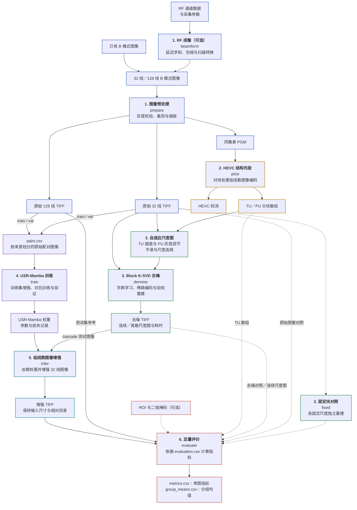
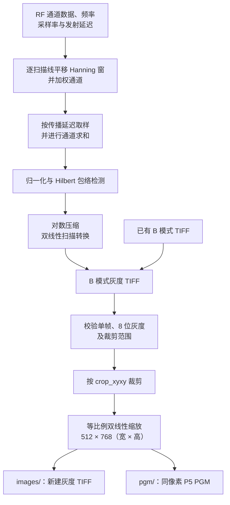
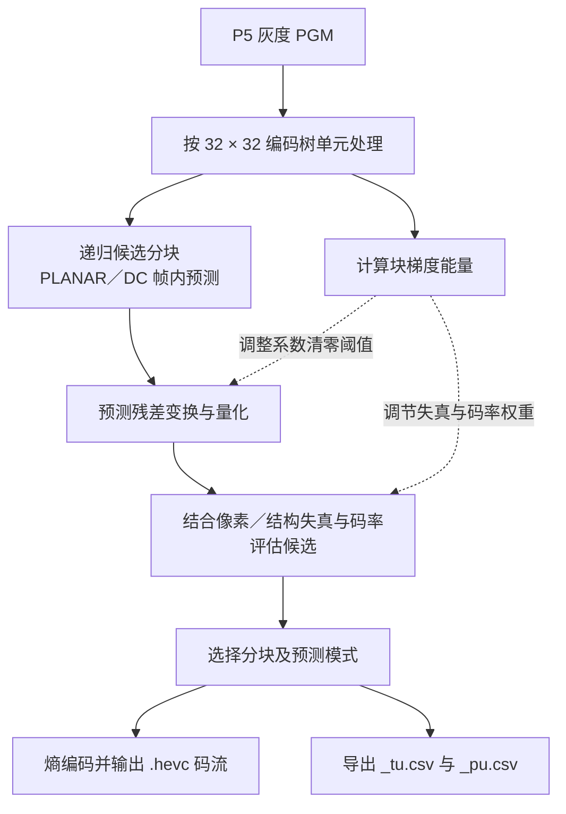
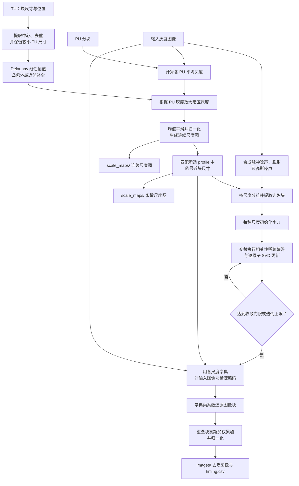
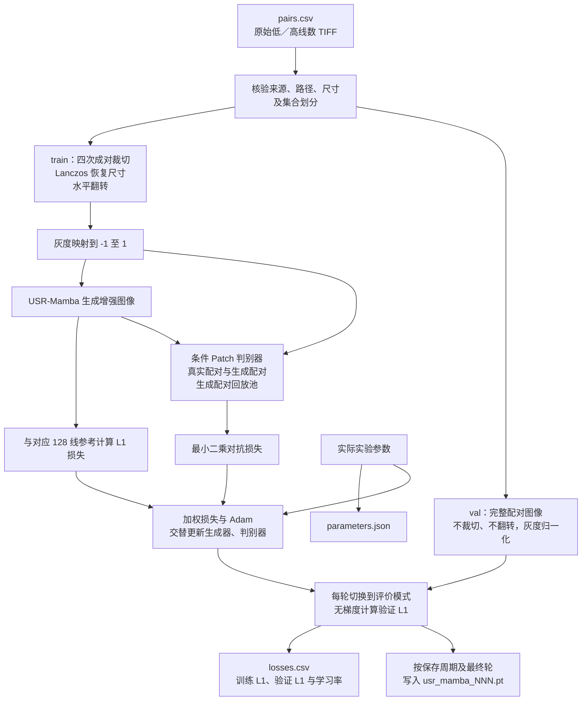
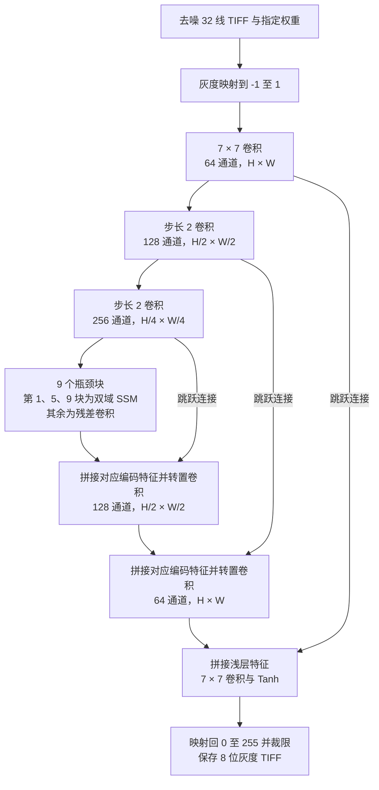
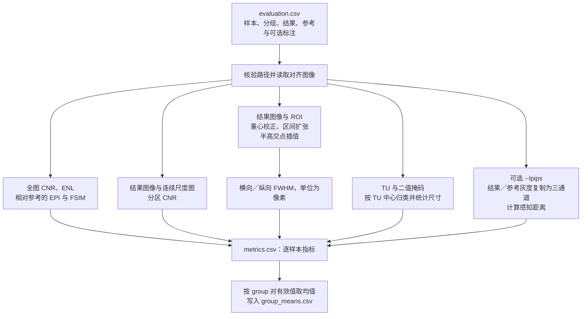

# 基于自适应压缩感知与状态空间模型的超声图像增强方法

语言：简体中文 | [English](README.md)

本项目实现从超声 RF 数据或 B 模式图像出发，提取 HEVC 分块结构先验，进行自适应 Block K-SVD 去噪，再通过 USR-Mamba 增强低线数图像并计算评价指标的完整流程。[最终论文](thesis.pdf)保留在根目录。

论文主路径为 **32 线图像 → HEVC 结构先验 → 三尺度 Block K-SVD 去噪 → USR-Mamba 推理 → 与原生 128 线参考图像比较**。网络训练使用预处理后的原始 32 线／128 线配对图像；前级去噪接入推理路径。32／128 表示波束线数，网络输入输出保持相同像素尺寸。

## 完整流程图

实线表示主要处理和数据依赖，虚线表示可选对照或辅助评价输入。图中的阶段名与 `run.py` 子命令对应；训练、推理和评价通过清单、权重及输出目录衔接，需要分别执行。阶段编号与下方分步说明一致，以边框颜色区分阶段，文字和底色跟随显示主题。



Block K-SVD 提供两组配置：`cascade` 使用 4、8、12 三种块尺寸，作为 USR-Mamba 前级；`denoising` 使用 4、8、12、16、20、24 六种块尺寸，用于独立去噪实验。完整图中的 `denoise` 按所选配置分别运行，`fixed` 为各固定块尺寸生成独立对照结果。

## 阶段与代码入口

| 阶段 | 目录 | 输入与输出 |
| --- | --- | --- |
| 1. 成像与预处理 | `imaging/` | `beamform`（可选）、`prepare`：RF 或 B 模式图像 → 对齐的灰度 TIFF／PGM |
| 2. 结构先验 | `hevc_prior/` | `prior`：PGM → HEVC 码流、TU／PU 数值数组 |
| 3. 自适应稀疏去噪 | `block_ksvd/` | `denoise`／`fixed`：图像及先验 → 去噪图像、尺度图与耗时 |
| 4. 网络训练 | `usr_mamba/` | `train`：原始低／高线数配对图像及清单 → 权重与训练／验证记录 |
| 5. 状态空间增强 | `usr_mamba/` | `infer`：去噪低线数图像及权重 → 增强图像 |
| 6. 指标计算 | `evaluation/` | `evaluate`：配准图像、尺度图及标注 → 单图与分组指标 |

`run.py` 提供统一入口，`configs/paper.json` 集中定义实验参数；数据位置、输出位置、MATLAB、编码器和计算设备均由命令行传入。`common/` 只处理配置、输入约定及 MATLAB 调用。

## 项目结构

```text
hevc-ksvd-mamba-for-ultrasound/
|-- README.md                    英文文档。
|-- README_zh-CN.md              简体中文文档。
|-- thesis.pdf                   最终论文。
|-- run.py                       统一命令行入口。
|-- CMakeLists.txt               HEVC 编码器构建配置。
|-- requirements.txt             Python 核心依赖。
|-- requirements-perceptual.txt  可选的感知评价依赖。
|-- LICENSE                      项目许可证。
|-- .gitignore                   排除本地数据、结果、构建产物及编辑器文件。
|-- configs/
|   `-- paper.json               实验参数。
|-- common/                      配置、输入约定及 MATLAB 调用。
|-- imaging/                     RF 波束成形与图像预处理。
|-- hevc_prior/                  HEVC 编码器与分块先验提取。
|-- block_ksvd/                  尺度图、字典学习、稀疏编码与重建。
|-- usr_mamba/                   配对数据、网络、训练与推理。
|-- evaluation/                  图像、区域、分块与感知评价指标。
|-- docs/
|   |-- reproduction.md          环境配置与各阶段命令。
|   |-- data_contract.md         输入与清单格式。
|   |-- validation.md            验证记录与实测范围。
|   `-- archive_manifest.json    归档文件清单与 SHA-256 校验值。
|-- licenses/
|   `-- third_party.txt          第三方许可证说明。
`-- tools/
    |-- smoke_test.py            合成输入端到端验证。
    `-- verify_archive.py        归档范围与完整性校验。
```

两份 README 对应相同的处理流程、公式与代码入口。本地 `work/`、数据、输出、权重、构建产物和编辑器工作区文件由 `.gitignore` 排除，不属于上方受跟踪的源码结构。

## 论文公式索引

以下按处理阶段整理[最终论文](thesis.pdf)第 2–4 章的全部 **39 个编号公式**，保留原式编号，并补充符号、参数及代码对应关系。标为“实现补充”的公式用于展开当前程序的计算步骤，不占用论文编号。论文采用的符号在不同章节可能复用，各组公式分别定义。

| 公式 | 内容 | README 位置 |
| --- | --- | --- |
| （2-1）–（2-5） | 量化选择、率失真代价、平方误差和及基础权重 | [HEVC 公式](#paper-hevc-equations) |
| （2-6）–（2-12） | 结构失真、双向梯度、动态权重与 TU 梯度能量 | [HEVC 公式](#paper-hevc-equations) |
| （2-13）–（2-15） | 系数群基础与自适应清零阈值 | [HEVC 公式](#paper-hevc-equations) |
| （3-1）–（3-7） | 稀疏表示、选原子、残差、SVD 更新与重叠融合 | [K-SVD 公式](#paper-ksvd-equations) |
| （3-8）–（3-12） | TU 插值、PU 灰度放大、尺度归一化、多字典与高斯窗 | [自适应尺度公式](#paper-scale-equations) |
| （4-1）–（4-6） | 编码、瓶颈、双域分支、解码及扫描状态更新 | [USR-Mamba 公式](#paper-mamba-equations) |
| （3-13）–（3-18） | CNR、ENL、EPI、FSIM、FWHM 与尺度区域加权评价 | [评价公式](#paper-metric-equations) |
| 实现补充 | 输入归一化、训练损失、学习率、分区 CNR 等 | [训练公式](#implementation-training-equations)、[评价公式](#paper-metric-equations) |

## 分步处理流程

### 1. RF 成像与图像预处理

输入可为包含通道信号及物理采集参数的 MAT 文件，也可为已有的单帧 8 位灰度 TIFF。RF 输入先通过 `beamform` 生成 B 模式 TIFF，已有图像直接进入 `prepare`。低／高线数配对必须配准并采用相同预处理，训练、验证和测试来源由数据提供者事先划分。



默认裁剪窗口为 `(0,0,750,1125)`，右／下边界不包含在裁剪区域内。预处理输出保留中性文件名及相对目录，并重新写入像素，移除原 TIFF 元数据。HEVC 输入宽高须为 32 的倍数。

对应实现：[RF 成像](imaging/beamform_rf.m)、[预处理](imaging/preprocess.py)。

### 2. HEVC 结构先验提取

`prior` 对 PGM 进行帧内编码，利用图像结构决定预测单元（PU）和变换单元（TU）的分块。后续去噪读取的是分块数组，图像像素来自预处理 TIFF。



质量索引 0–4 对应 QP 4、10、16、22、28，默认索引为 0。TU／PU CSV 均无表头，每行是 `[block_size,x,y]`，坐标以左上角为原点、从 0 开始；相对目录和样本名与输入一致。

<a id="paper-hevc-equations"></a>

#### 论文公式：率失真与结构自适应量化

设 $`c_i`$ 为第 $`i`$ 个变换系数，$`l_{i,k}`$ 为其第 $`k`$ 个候选量化值，$`D(c_i,l_{i,k})`$ 为量化失真，$`R(l_{i,k})`$ 为编码比特数，$`\lambda`$ 为拉格朗日乘子。论文的量化选择准则为：

```math
l_i^*=\underset{k}{\mathrm{argmin}}
\left\{D(c_i,l_{i,k})+\lambda R(l_{i,k})\right\}.
\qquad\text{(2-1)}
```

这里 $`l_i^*`$ 表示上述最优候选所对应的量化值。设 $`X_{\mathrm{orig}}`$、$`X_{\mathrm{rcon}}`$ 分别为原始块和重建块，传统率失真代价写为：

```math
\mathrm{RD}_{\mathrm{cost}}
=D_{\mathrm{SSE}}(X_{\mathrm{orig}},X_{\mathrm{rcon}})+\lambda R.
\qquad\text{(2-2)}
```

编码器以离散质量索引 $`q=\mathrm{qpd6}\in\{0,1,2,3,4\}`$ 查表设置失真与比特数权重，等价地写成：

```math
\mathrm{RD}_{\mathrm{cost}}
=w_d(q)D_{\mathrm{SSE}}+w_b(q)R.
\qquad\text{(2-3)}
```

```math
D_{\mathrm{SSE}}
=\sum_{i=0}^{\mathrm{sz}-1}\sum_{j=0}^{\mathrm{sz}-1}
\left(X^{\mathrm{orig}}_{i,j}-X^{\mathrm{rcon}}_{i,j}\right)^2.
\qquad\text{(2-4)}
```

```math
\begin{cases}
w_d(q)=[11,11,11,5,1]_q,\\
w_b(q)=[1,4,16,29,23]_q.
\end{cases}
\qquad\text{(2-5)}
```

其中 $`\mathrm{sz}`$ 为 TU 边长，$`R`$ 为当前 TU 的编码比特数；$`q`$ 对应配置中的 `quality_index`，不是直接使用 QP 数值作为数组下标。

改进后，追加原始块与重建块之间的梯度差惩罚，并动态调整两项权重：

```math
\mathrm{RD}'_{\mathrm{cost}}=w'_dD_{\mathrm{struct}}+w'_bR.
\qquad\text{(2-6)}
```

```math
D_{\mathrm{struct}}=D_{\mathrm{SSE}}
+\sum_{i=1}^{\mathrm{sz}-2}\sum_{j=1}^{\mathrm{sz}-2}
\left(
\left|G_x^{\mathrm{orig}}-G_x^{\mathrm{rcon}}\right|
+\left|G_y^{\mathrm{orig}}-G_y^{\mathrm{rcon}}\right|
\right).
\qquad\text{(2-7)}
```

```math
\begin{cases}
G_x^{\mathrm{orig}}=X^{\mathrm{orig}}_{i,j+1}-X^{\mathrm{orig}}_{i,j-1},\\
G_y^{\mathrm{orig}}=X^{\mathrm{orig}}_{i+1,j}-X^{\mathrm{orig}}_{i-1,j}.
\end{cases}
\qquad\text{(2-8)}
```

```math
\begin{cases}
G_x^{\mathrm{rcon}}=X^{\mathrm{rcon}}_{i,j+1}-X^{\mathrm{rcon}}_{i,j-1},\\
G_y^{\mathrm{rcon}}=X^{\mathrm{rcon}}_{i+1,j}-X^{\mathrm{rcon}}_{i-1,j}.
\end{cases}
\qquad\text{(2-9)}
```

```math
w'_d=
\begin{cases}
\min\left\{w_d(q)+\min\{G_{\mathrm{TU}}-1,12\},24\right\},
&G_{\mathrm{TU}}>2,\\
w_d(q),&G_{\mathrm{TU}}\le2.
\end{cases}
\qquad\text{(2-10)}
```

```math
w'_b=
\begin{cases}
\max\left\{w_b(q)-\min\{G_{\mathrm{TU}}-1,12\},1\right\},
&G_{\mathrm{TU}}>2,\\
w_b(q),&G_{\mathrm{TU}}\le2.
\end{cases}
\qquad\text{(2-11)}
```

```math
G_{\mathrm{TU}}=\frac{1}{\mathrm{sz}^2}
\sum_{i=1}^{\mathrm{sz}-2}\sum_{j=1}^{\mathrm{sz}-2}
\left(\left|G_x^{\mathrm{orig}}\right|+\left|G_y^{\mathrm{orig}}\right|\right).
\qquad\text{(2-12)}
```

梯度只在块内部计算，但能量按完整块面积 $`\mathrm{sz}^2`$ 归一化。高梯度区域增大失真项权重、减小比特数项权重，使细粒度结构在候选比较中更受重视。当前 C 编码器对 $`G_{\mathrm{TU}}`$ 使用整数除法，结构梯度差的系数由 `structure_weight` 控制，默认值为 1。

系数群（CG）原清零阈值、基础阈值及自适应阈值分别为：

```math
T_{\mathrm{CG}}=\frac{9\times2^{\mathrm{sft}}}{4}
=9\times2^{\mathrm{sft}-2}.
\qquad\text{(2-13)}
```

```math
T_{\mathrm{base}}=T_{\mathrm{CG}}=9\times2^{\mathrm{sft}-2}.
\qquad\text{(2-14)}
```

```math
T_{\mathrm{adaptive}}=
\begin{cases}
\max\{T_{\mathrm{base}}/2,1\},&G_{\mathrm{TU}}>2,\\
T_{\mathrm{base}},&G_{\mathrm{TU}}\le2.
\end{cases}
\qquad\text{(2-15)}
```

其中 $`\mathrm{sft}=\mathrm{LEVEL\_SHIFT\_TABLE}[\mathrm{sz}/8]+q`$，表下标按编码器整数运算解释。代码通过移位实现阈值缩放及整数截断；`zero_multiplier=9`、`zero_shift=2`、`zero_reduction_shift=1` 对应上述默认式。该阈值只控制系数群清零判定，候选量化等级仍按代价比较。

对应实现：[先验提取入口](hevc_prior/runner.py)、[编码器](hevc_prior/codec.c)。

### 3. 自适应尺度图与 Block K-SVD 去噪

`denoise` 将图像、TU 和 PU 结合，先生成每个像素的块尺度，再按实际出现的尺度分别学习字典和重建。字典训练图像由当前输入叠加合成脉冲／高斯噪声得到；最终稀疏重建使用当前输入图像的块。



中心不足或共线时，尺度插值回退到最近邻。默认字典为 512 个原子、稀疏率 0.1、最多迭代 10 轮。连续尺度图用于后续尺度分区评价，离散尺度图决定逐像素块尺寸。

| `--profile` | 块边长（像素） | 用途 |
| --- | --- | --- |
| `cascade` | 4、8、12 | USR-Mamba 推理前级 |
| `denoising` | 4、8、12、16、20、24 | 独立去噪与固定块对照 |

`fixed` 跳过 TU／PU 尺度估计，对配置中的每种固定块尺寸分别学习、重建，并使用等权重融合；同一图像的各固定尺度共享同一份合成训练噪声。结果写入 `images/fixed_04/` 等目录。

<a id="paper-ksvd-equations"></a>

#### 论文公式：稀疏表示与 K-SVD 更新

将 $`m`$ 个图像块展开为列向量，组成 $`X=[x_1,\ldots,x_m]\in\mathbb{R}^{d\times m}`$；$`D\in\mathbb{R}^{d\times K}`$ 为字典，$`A=[a_1,\ldots,a_m]\in\mathbb{R}^{K\times m}`$ 为稀疏系数。这里以 $`d`$ 表示论文中的块向量维数 $`n`$，避免与后文尺度层数混淆。字典学习目标为：

```math
\min_{D,A}\|X-DA\|_F^2,
\qquad \mathrm{s.t.}\quad \|a_i\|_0\le L,\quad i=1,\ldots,m.
\qquad\text{(3-1)}
```

$`\|\cdot\|_F`$ 为 Frobenius 范数，$`\|\cdot\|_0`$ 为非零元素数，$`L`$ 为单块允许使用的原子数。字典列初始归一化到单位二范数。论文给出的第 $`\ell`$ 步选原子与残差更新为：

```math
I_\ell=\underset{j}{\mathrm{argmax}}
\left\{d_j^{\mathsf T}r_{\ell-1}\right\}.
\qquad\text{(3-2)}
```

```math
r_\ell=r_{\ell-1}-a_{I_\ell}d_{I_\ell}.
\qquad\text{(3-3)}
```

其中 $`r_0=x_i`$。 **实现补充：** 当前 `sparse_encode.m` 在尚未选取的原子中最大化相关性的 **绝对值**，并令 $`a_{I_\ell}=d_{I_\ell}^{\mathsf T}r_{\ell-1}`$，再按式（3-3）更新；不进行已选原子的联合最小二乘重估。它采用论文所述的逐次相关选择与残差更新规则，应与严格的正交匹配追踪实现区分。停止条件为已选 $`L`$ 个原子或 $`\|r_\ell\|_2\le\varepsilon`$；默认 $`K=512`$、$`L=\mathrm{round}(0.1K)=51`$、$`\varepsilon=46225`$，数值按当前输入量纲直接比较。

对于第 $`t`$ 个字典原子，取激活样本集合 $`\mathcal{I}_t=\{i:A(t,i)\ne0\}`$，先补回该原子的贡献，构造局部残差：

```math
R_t=X(:,\mathcal{I}_t)-DA(:,\mathcal{I}_t)
+d_tA(t,\mathcal{I}_t).
\qquad\text{(3-4)}
```

```math
R_t\approx U\Sigma V^{\mathsf T}.
\qquad\text{(3-5)}
```

```math
\begin{cases}
d_t\leftarrow U(:,1),\\
A(t,\mathcal{I}_t)\leftarrow\Sigma(1,1)V(:,1)^{\mathsf T}.
\end{cases}
\qquad\text{(3-6)}
```

代码用 `svds(local,1)` 求上述秩一更新；若原子没有激活样本，当前实现将全部样本作为更新集合。每轮更新后重新稀疏编码，计算 $`e_k=\|X-DA\|_F/\sqrt{dm}`$，在 $`|e_k-e_{k-1}|<0.0009`$ 或达到 10 轮时停止，初始比较值 $`e_0=0`$。

设第 $`q`$ 个重建块为 $`\hat{x}_q`$，其权重窗为 $`w_q`$；在全图坐标中只对覆盖当前像素的块求和，得到：

```math
\hat{I}(i,j)=
\frac{\sum_q w_q(i,j)\hat{x}_q(i,j)}{\sum_q w_q(i,j)}.
\qquad\text{(3-7)}
```

<a id="paper-scale-equations"></a>

#### 论文公式：连续尺度、多字典与高斯融合

设像素 $`p`$ 位于三个 TU 中心构成的三角形内，顶点尺度为 $`s_1,s_2,s_3`$，重心坐标为 $`\lambda_1,\lambda_2,\lambda_3`$，则：

```math
\begin{cases}
s(p)=\lambda_1s_1+\lambda_2s_2+\lambda_3s_3,\\
\lambda_1+\lambda_2+\lambda_3=1.
\end{cases}
\qquad\text{(3-8)}
```

三角形内 $`\lambda_k\ge0`$；凸包外用最近邻补全，中心不足或共线时整体回退到最近邻。设 $`\bar{g}_{\mathrm{PU}}(p)`$ 为像素所在 PU 的平均灰度，$`g_{\max}`$ 为所有 PU 平均灰度的最大值，放大后尺度为：

```math
s'(p)=s(p)\left[
1+\alpha\left(1-\frac{\bar{g}_{\mathrm{PU}}(p)}{g_{\max}}\right)^\gamma
\left(\frac{32}{s(p)}-1\right)
\right].
\qquad\text{(3-9)}
```

默认 $`\alpha=0.5`$、$`\gamma=6`$，32 对应 `structure_limit`。暗区的放大幅度较大；代码以 $`\max(g_{\max},\mathrm{eps})`$ 防止全黑图除零。随后采用半径 12、窗口 $`25\times25`$ 的均值滤波。为保留论文符号，式（3-10）中的 $`s'`$ 指经过该平滑步骤后的尺度图。

论文将连续尺度归一化到 $`[4-b_0,4n]`$，这里把原式的下界调节参数 $`b`$ 记为 $`b_0`$，以便与后文块边长 $`b`$ 区分：

```math
\tilde{s}(p)=(4-b_0)+
\frac{s'(p)-s'_{\min}}{s'_{\max}-s'_{\min}}
\left(4n-(4-b_0)\right).
\qquad\text{(3-10)}
```

**实现补充：** 代码以 `lower_bound` 直接指定下界 $`a`$，以所选尺度集合 $`\mathcal{B}`$ 的最大值指定上界，默认 $`a=0`$，对应原式 $`b_0=4`$：

```math
\tilde{s}(p)=a+
\frac{s'(p)-s'_{\min}}{s'_{\max}-s'_{\min}}(\max\mathcal{B}-a),
\qquad
s_{\mathrm{disc}}(p)=\underset{b\in\mathcal{B}}{\mathrm{argmin}}
\left|\tilde{s}(p)-b\right|.
```

若尺度图近似常量，代码直接令连续图和离散图均为 $`\min\mathcal{B}`$；最近尺度并列时取配置中先出现的较小值。独立去噪取 $`n=6`$、$`\mathcal{B}=\{4,8,12,16,20,24\}`$，级联前级取 $`n=3`$、$`\mathcal{B}=\{4,8,12\}`$。

属于块边长 $`b`$ 的训练样本矩阵、字典及稀疏系数分别记为 $`X_b,D_b,A_b`$，各活跃尺度独立求解：

```math
\min_{D_b,A_b}\|X_b-D_bA_b\|_F^2,
\qquad \mathrm{s.t.}\quad\|a_i^{(b)}\|_0\le L.
\qquad\text{(3-11)}
```

每个块的向量维数为 $`b^2`$。训练样本来自叠加合成噪声的图像，最终编码块来自当前输入图像。重建后的块按式（3-7）融合，自适应分块采用高斯窗：

```math
w_b(i,j)=\exp\left[-\frac{(i-c)^2+(j-c)^2}{2(\eta b)^2}\right].
\qquad\text{(3-12)}
```

其中局部坐标 $`i,j\in\{1,\ldots,b\}`$，$`c=(b+1)/2`$，$`\eta=0.5`$ 对应 `fusion_sigma_ratio`。固定块对照使用 $`w_b(i,j)=1`$，每种固定尺度分别输出一幅图像。

对应实现：[批量去噪](block_ksvd/batch_denoise.m)、[尺度图](block_ksvd/scale_map.m)、[字典学习](block_ksvd/dictionary_learning.m)、[稀疏编码](block_ksvd/sparse_encode.m)、[重建与融合](block_ksvd/reconstruct_image.m)。

### 4. USR-Mamba 配对训练与独立验证

`train` 读取 `pairs.csv`，以预处理后的原始 32 线图像为输入、原始 128 线图像为参考。清单包含 `source_id,split,input,reference`，`split` 为 `train`、`val` 或 `test`；训练入口只使用前两者，并核验来源及文件划分。



默认批量为 1、学习率为 0.0002、Adam 参数为 `(0.5,0.999)`；先恒定学习率训练 30 轮，再线性衰减训练 30 轮。生成器损失为 `10 × L1 + 1 × 最小二乘对抗损失`。每个训练来源得到四组确定的成对裁切，只裁左右和底部 0–32 像素、顶部不变，再通过水平翻转形成八个样本；验证集保持独立。权重默认每 5 轮及最终轮保存，记录模型结构与变体。

`--variant` 支持完整模型 `full`，以及纯卷积瓶颈 `conv_bottleneck`、去傅里叶分支 `no_fourier`、去 SSM 后残差精炼 `no_refinement`、行优先扫描 `raster_scan` 四种结构消融。

<a id="implementation-training-equations"></a>

#### 实现补充：输入、训练损失与学习率

对 8 位灰度值 $`I`$，网络输入的归一化为 $`x=I/127.5-1`$。设原始 32 线训练输入为 $`x`$，配对 128 线参考为 $`y`$，生成器为 $`G`$，条件判别器为 $`D`$，$`\langle\cdot\rangle`$ 表示对批次及相应像素或判别图元素取均值，则当前训练目标为：

```math
\begin{aligned}
\hat{y}&=G(x),\\
\mathcal{L}_1&=\left\langle|\hat{y}-y|\right\rangle,\\
\mathcal{L}_{\mathrm{adv}}&=
\left\langle\left(D([x;\hat{y}])-1\right)^2\right\rangle,\\
\mathcal{L}_G&=10\mathcal{L}_1+\mathcal{L}_{\mathrm{adv}},\\
\mathcal{L}_D&=\frac12\left[
\left\langle\left(D([x;y])-1\right)^2\right\rangle+
\left\langle D(\mathcal{R}([x;\mathrm{stopgrad}(\hat{y})]))^2\right\rangle
\right].
\end{aligned}
```

$`[\cdot;\cdot]`$ 为通道拼接，$`\mathcal{R}`$ 为容量 50、历史替换概率 0.5 的生成配对回放池；`stopgrad` 表示更新判别器时不向生成器回传梯度。损失权重分别由 `l1_weight`、`adversarial_weight` 配置；上式给出默认值，代码还以 `adversarial_weight` 缩放判别器损失，设为 0 时跳过对抗更新。验证集只计算 $`\mathcal{L}_1`$。

设轮次 $`e`$ 从 1 开始，恒定阶段 $`E_c=30`$、衰减阶段 $`E_d=30`$，初始学习率 $`r_0=0.0002`$，代码实际使用：

```math
r(e)=r_0\left(1-\frac{\max(0,e-E_c)}{E_d+1}\right),
\qquad e=1,\ldots,E_c+E_d.
```

因此最后一轮学习率为 $`r_0/31`$。默认用 Adam、$`\beta_1=0.5`$、$`\beta_2=0.999`$ 交替更新生成器和判别器。

对应实现：[配对数据与划分](usr_mamba/dataset.py)、[训练与验证](usr_mamba/training.py)。

### 5. USR-Mamba 网络与低线数推理

`infer` 加载指定权重及其中记录的模型结构，对 `cascade` 输出的去噪 32 线图像进行增强。以下是默认完整模型的数据流，`H × W` 表示输入的高和宽。



双域 SSM 包含两条分支：空间特征经二维扫描、LayerNorm 和 Mamba 后还原；频域特征经二维 FFT 与中心化，将实部／虚部拼接后扫描建模，再逆变换回空间域。两分支融合后，与输入特征拼接融合，并进行残差卷积精炼。默认扫描顺序为从边界向中心逐层绕行的 `outside_in`。

推理采用评价模式并关闭梯度，输入宽高须能被默认下采样因子 4 整除。输出保留尺寸、样本名和相对目录。原始 32 线输入对照可使用相同权重另行执行 `infer`。

<a id="paper-mamba-equations"></a>

#### 论文公式：编码、双域状态空间与解码

设 $`I_{\mathrm{LR}}`$ 为低波束线图像，$`I_{\mathrm{HR}}`$ 为高波束线参考，$`U`$ 为输入尺寸变换，$`E`$ 为编码器，$`f_1`$ 为瓶颈输入，$`\{s_l\}_{l=1}^{L}`$ 为跳连特征集合：

```math
\begin{cases}
X=U(I_{\mathrm{LR}}),\\
\left(f_1,\{s_l\}_{l=1}^{L}\right)=E(X).
\end{cases}
\qquad\text{(4-1)}
```

论文允许在预处理已得到目标尺寸时直接使用同尺寸输入。本项目的 32／128 线图像已处于同一像素网格，故这里 $`U`$ 为恒等尺寸映射，灰度另按前述公式归一化。

设瓶颈阶段数 $`J=9`$，双域模块位置集合 $`S=\{1,5,9\}`$，则论文的阶段更新为：

```math
\begin{cases}
\tilde{f}_j=
\begin{cases}
\mathcal{D}_j(f_j),&j\in S,\\
f_j,&j\notin S,
\end{cases}\\
f_{j+1}=\mathrm{rCNN}_j(\tilde{f}_j),\quad j=1,\ldots,J.
\end{cases}
\qquad\text{(4-2)}
```

$`\mathcal{D}_j`$ 为双域 SSM 模块，$`\mathrm{rCNN}_j`$ 为残差卷积精炼。令 $`\mathcal{F}`$、$`\mathcal{F}^{-1}`$ 分别为傅里叶变换及逆变换，$`\mathcal{R}`$ 将复频谱实部和虚部沿通道拼接，$`\mathcal{R}^{-1}`$ 将其重新组合为复数，则：

```math
\begin{cases}
u_I=\mathcal{M}_{I,j}(f_j),\\
u_F=\mathcal{F}^{-1}\!\left(
\mathcal{R}^{-1}\!\left(\mathcal{M}_{F,j}\!\left(
\mathcal{R}(\mathcal{F}(f_j))\right)\right)\right),\\
\mathcal{D}_j(f_j)=P_j([u_I;u_F]).
\end{cases}
\qquad\text{(4-3)}
```

其中 $`\mathcal{M}_{I,j}`$、$`\mathcal{M}_{F,j}`$ 分别为空间域和频域分支，$`P_j`$ 为通道投影。此处的 $`\mathcal{R}`$ 是复数重排，与训练小节的回放池符号分别使用。代码对二维 FFT 使用 `fftshift` 中心化，逆变换前使用 `ifftshift`，并取逆变换结果实部；空间序列通道数为 $`C`$，频域实／虚序列通道数为 $`2C`$。

对任一分支输入 $`q`$，论文以通道扩展、局部卷积、门控 SSM 及通道混合描述分支计算：

```math
\begin{cases}
g=\sigma(\mathrm{Lin}_{\beta}(q)),\\
e=\sigma(\mathrm{DWConv}(\mathrm{Lin}_{\beta}(q))),\\
M=\mathrm{SSM}_{\theta}(e),\\
e_{\mathrm{SSM}}=q+\mathrm{Lin}_{1/\beta}(g\odot M),\\
\mathcal{M}_{*,j}(q)=\mathrm{cmConv}(e_{\mathrm{SSM}})
+\mathrm{Conv}(e_{\mathrm{SSM}}),\quad *\in\{I,F\}.
\end{cases}
\qquad\text{(4-4)}
```

$`\mathrm{Lin}_{\beta}`$ 与 $`\mathrm{Lin}_{1/\beta}`$ 分别扩展和压缩通道，$`\mathrm{DWConv}`$ 为深度卷积，$`\sigma`$ 为激活，$`\odot`$ 为逐元素乘法，$`\mathrm{cmConv}`$ 为通道混合卷积。空间分支取 $`q=f_j`$，频域分支取 $`q=\mathcal{R}(\mathcal{F}(f_j))`$。 **实现对应：** 式（4-4）保留论文的模块级表达；当前每个分支具体调用 `LayerNorm` 和 `mamba_ssm.Mamba`，外部再由 `DualDomainState`、`FeatureFusion` 和 `ResidualConvolution` 完成双域融合、输入拼接融合及残差精炼，并未逐项显式搭建式中的所有独立层。

解码器 $`D`$ 融合瓶颈输出与跳连特征：

```math
\hat{I}_{\mathrm{HR}}=D\left(f_{J+1},\{s_l\}_{l=1}^{L}\right).
\qquad\text{(4-5)}
```

此处 $`D`$ 指解码器，与训练小节中的判别器分别使用。当前输出头使用 Tanh，保存前按 $`\mathrm{clip}(127.5(\hat{y}+1),0,255)`$ 映射回灰度并转换为 8 位 TIFF。

#### 论文公式：扫描序列与状态更新

设特征图大小为 $`H\times W`$，扫描路径 $`p(n)=(h[n],w[n])`$ 是二维位置的一个排列，$`n=1,\ldots,HW`$，通道索引为 $`c`$。序列化、状态递推与逆排列还原为：

```math
\begin{cases}
z_{\mathrm{in}}[n,c]=e[p(n),c],\\
\ell[n,c]=\bar{A}\ell[n-1,c]+\bar{B}[n]z_{\mathrm{in}}[n,c],\\
z_{\mathrm{out}}[n,c]=\bar{C}[n]\ell[n,c],\\
M[p(n),c]=z_{\mathrm{out}}[n,c].
\end{cases}
\qquad\text{(4-6)}
```

$`\ell[n,c]`$ 为隐藏状态，$`\bar{A}`$ 为状态转移参数，$`\bar{B}[n]`$、$`\bar{C}[n]`$ 为输入相关参数。扫描只改变排列，不改变特征数量，也不进行插值。论文正文将角向均匀扫描描述为由中心向外的近似螺旋路径；当前配置默认 `outside_in`，实现为沿矩形边界逐层向中心绕行，`inside_out` 为其逆序。式（4-6）适用于这些排列，但两种方向不应视作同一实验设置，具体复现以保存的 `scan_order` 为准。

对应实现：[网络结构](usr_mamba/network.py)、[推理与图像保存](usr_mamba/inference.py)。

### 6. 定量评价与分组统计

`evaluate` 读取 `evaluation.csv`，每行指定参考图像、方法结果及可选的连续尺度图、ROI、TU 和掩码。结果与参考必须处于相同像素坐标系；原始输入、固定块去噪、自适应去噪和网络增强结果可分别建立清单进行比较。



全图 `global_cnr` 使用均值／样本标准差，ENL 使用均值平方／样本方差；EPI 使用 Sobel 梯度相关。FSIM 使用多尺度 LoG 相位响应近似，具体口径见[复现指南](docs/reproduction.md)。尺度分区 CNR 默认将连续尺度图的 `[0,4)` 作为目标、`(8,12]` 作为背景、`[0,12]` 作为噪声统计范围。

缺少对应尺度图、ROI 或 TU／掩码时，相关指标保留为缺失值（NaN）；LPIPS 通过 `--lpips` 显式启用，需要额外特征评价依赖和公开特征权重。

<a id="paper-metric-equations"></a>

#### 论文公式：全图统计与结构保持

设待评价图像有 $`N`$ 个像素，灰度均值为 $`\mu`$，样本方差为 $`\sigma^2=\frac{1}{N-1}\sum_p(I(p)-\mu)^2`$。第 3 章的全图 CNR 与 ENL 为：

```math
\mathrm{CNR}=\frac{\mu}{\sigma}.
\qquad\text{(3-13)}
```

```math
\mathrm{ENL}=\frac{\mu^2}{\mathrm{Var}(I)}.
\qquad\text{(3-14)}
```

当前 CSV 中分别为 `global_cnr`、`enl`，均按整幅结果图计算，分母以 `eps` 保护；非退化情形下有 $`\mathrm{ENL}=\mathrm{global\_cnr}^2`$。这两个量反映均值与波动的关系，应结合结构指标解读。

令 $`\nabla I`$ 表示 Sobel 梯度幅值，去噪前后边缘保持指数为：

```math
\mathrm{EPI}=\mathrm{corr}
\left(\nabla I_{\mathrm{orig}},\nabla I_{\mathrm{den}}\right).
\qquad\text{(3-15)}
```

`evaluate` 实际以清单中的 `reference` 和 `result` 计算该相关系数。若任一梯度图标准差小于 `eps`，当前代码约定 EPI 为 1，此时不应将其解读为充分的边缘保持证据。

设 $`S_{\mathrm{GM}}`$、$`S_{\mathrm{PC}}`$ 为梯度幅值与相位一致性相似图，$`\mathrm{PC}_m`$ 为两张相位一致性图的逐像素最大值，FSIM 定义为：

```math
\mathrm{FSIM}=
\frac{\sum_p S_{\mathrm{GM}}(p)S_{\mathrm{PC}}(p)\mathrm{PC}_m(p)}
{\sum_p\mathrm{PC}_m(p)}.
\qquad\text{(3-16)}
```

**实现补充：** 当前程序用 Scharr 梯度幅值 $`G_1,G_2`$ 和多尺度 LoG 响应 $`P_1,P_2`$ 计算上述结构，其中 $`P`$ 是相位响应的近似：

```math
\begin{aligned}
P(I)&=\frac{1}{|\mathcal{S}|}
\sum_{s\in\mathcal{S}}|\mathrm{LoG}_s*I|,
\quad\mathcal{S}=\{1,2,4\},\\
S_{\mathrm{GM}}&=\frac{2G_1G_2+T_G}{G_1^2+G_2^2+T_G},
\quad T_G=0.0026,\\
S_{\mathrm{PC}}&=\frac{2P_1P_2+T_P}{P_1^2+P_2^2+T_P},
\quad T_P=0.85,\\
\mathrm{PC}_m&=\max(P_1,P_2).
\end{aligned}
```

$`*`$ 表示卷积，其他乘法、平方和最大值按像素计算，图像采用 `[0,1]` 灰度。该 FSIM 使用 LoG 近似，与通用相位一致性实现的数值口径有别。

#### 论文公式：亮点响应与尺度区域评价

设 $`f(t)`$ 为经 ROI 重心校正后提取的一维水平或垂直灰度剖面，半峰值左右交点为 $`t_L,t_R`$，则：

```math
\mathrm{FWHM}=t_R-t_L,
\qquad \mathrm{s.t.}\quad
f(t_L)=f(t_R)=\frac12\max_t f(t).
\qquad\text{(3-17)}
```

代码先以 ROI 内灰度不低于局部最大值 90% 的像素求灰度加权质心，将 ROI 中心向其移动，单方向漂移不超过该方向 ROI 长度的 25%；随后提取穿过调整后 ROI 中心的剖面。若半高范围触及边界，按原区间长度的 25% 逐步扩张，在相邻采样点间线性插值确定交点。单位为像素；第 4 章重点报告亮点组 `fwhm_x`，与原生 128 线参考比较。

对于块大小类别 $`b`$ 对应的区域 $`\Omega_b`$、像素评价量图 $`Q(p)`$ 和与重建一致的高斯权重 $`w_b(p)`$，论文给出的区域平均评价为：

```math
\bar{Q}_b=
\frac{\sum_{p\in\Omega_b}w_b(p)Q(p)}
{\sum_{p\in\Omega_b}w_b(p)}.
\qquad\text{(3-18)}
```

该式用于论文中按尺度分析局部贡献；当前 `evaluate` 入口尚未导出式（3-18）的逐尺度加权结果，`group_means.csv` 是按清单 `group` 对有效单图指标取算术均值，两者含义不同。

#### 实现补充：第 4 章分区 CNR、感知距离与 TU 统计

第 4 章按连续尺度图 $`\tilde{s}`$ 自动划分目标、背景及噪声区域，具体阈值和计算为：

```math
\begin{aligned}
\Omega_t&=\{p:0\le\tilde{s}(p)<4\},\\
\Omega_b&=\{p:8<\tilde{s}(p)\le12\},\\
\Omega_n&=\{p:0\le\tilde{s}(p)\le12\},\\
\mathrm{CNR}_{\mathrm{region}}&=
\frac{|\mu_{\Omega_t}-\mu_{\Omega_b}|}
{\max(\sigma_{\Omega_n},\mathrm{eps})}.
\end{aligned}
```

$`\mu_\Omega`$、$`\sigma_\Omega`$ 为结果图在区域 $`\Omega`$ 内的均值与样本标准差，CSV 字段为 `cnr`。该定义与式（3-13）的 `global_cnr` 分开报告；三类区域任一为空时保留 NaN。阈值由 `cnr_target`、`cnr_background`、`cnr_noise` 配置。

LPIPS 的当前调用可写为 $`d_{\mathrm{LPIPS}}=\mathrm{LPIPS}_{\mathrm{AlexNet}}(T(I_{\mathrm{result}}),T(I_{\mathrm{reference}}))`$，其中 $`T`$ 将 8 位灰度复制为三通道并映射至 $`[-1,1]`$，数值越低表示感知特征越接近参考。

论文还讨论了 PSNR 的局限；为便于对照，其定义为 $`\mathrm{MSE}=\frac1N\sum_p(I_{\mathrm{result}}(p)-I_{\mathrm{reference}}(p))^2`$、$`\mathrm{PSNR}=10\log_{10}(M^2/\mathrm{MSE})`$，$`M`$ 为灰度满量程（8 位灰度为 255，归一化灰度为 1）。当前评价入口未导出 PSNR；它也不是论文主要的增强评价指标。

TU 统计按块中心是否位于二值掩码内分为 ROI 与背景。设两类 TU 集合为 $`\mathcal{T}_r,\mathcal{T}_b`$，TU 边长为 $`s_t`$，则 `roi_tu_mean`、`background_tu_mean` 与 `tu_ratio` 对应：

```math
\bar{s}_r=\frac{1}{|\mathcal{T}_r|}\sum_{t\in\mathcal{T}_r}s_t,
\qquad
\bar{s}_b=\frac{1}{|\mathcal{T}_b|}\sum_{t\in\mathcal{T}_b}s_t,
\qquad \rho_{\mathrm{TU}}=\frac{\bar{s}_b}{\bar{s}_r}.
```

这是按 TU 个数计算的边长均值，不按块面积加权。缺少 TU／掩码时输出 NaN；提供标注但某类为空时，代码将该类均值置 0，ROI 均值为 0 时比值置 Inf。

对应实现：[评价入口](evaluation/runner.py)、[MATLAB 批量指标](evaluation/evaluate_batch.m)。

## 运行与复现

依次使用 `beamform`（可选）、`prepare`、`prior`、`denoise` 准备图像；通过 `train` 得到权重后执行 `infer`，最后通过 `evaluate` 汇总结果。已有兼容权重时可直接进入推理；`fixed` 及各网络变体用于独立对照。输入清单、标注和数据划分需事先准备。

环境安装、编码器构建和各阶段命令见[复现指南](docs/reproduction.md)，输入与清单格式见[数据契约](docs/data_contract.md)，已完成的合成验证及实测范围见[验证记录](docs/validation.md)。

归档包含流程源码、参数、必要许可证与论文，不包含采集数据、样本清单、ROI 实测标注、权重、实验结果、安装环境、编译产物或开发备份。运行目录默认排除在 Git 之外。

```sh
python -B run.py --help
python -B tools/verify_archive.py
```
